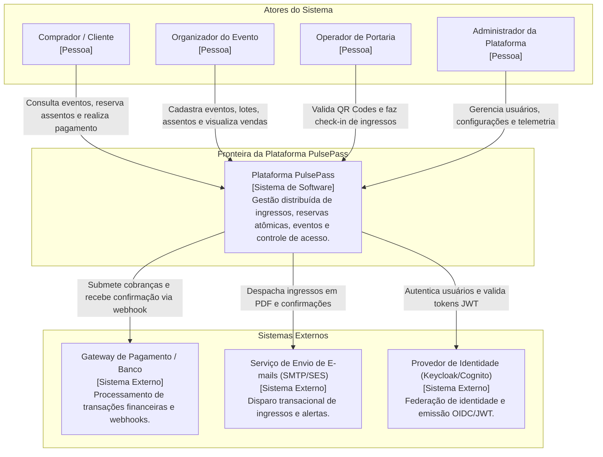
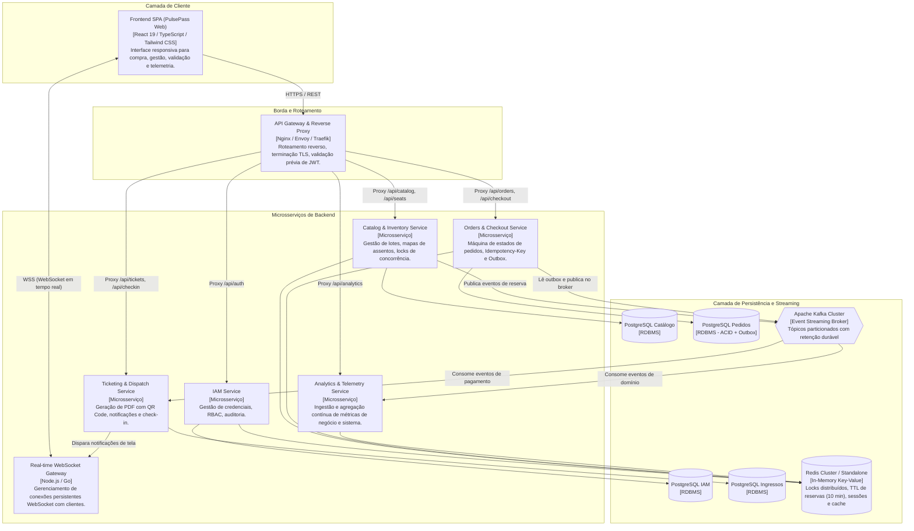
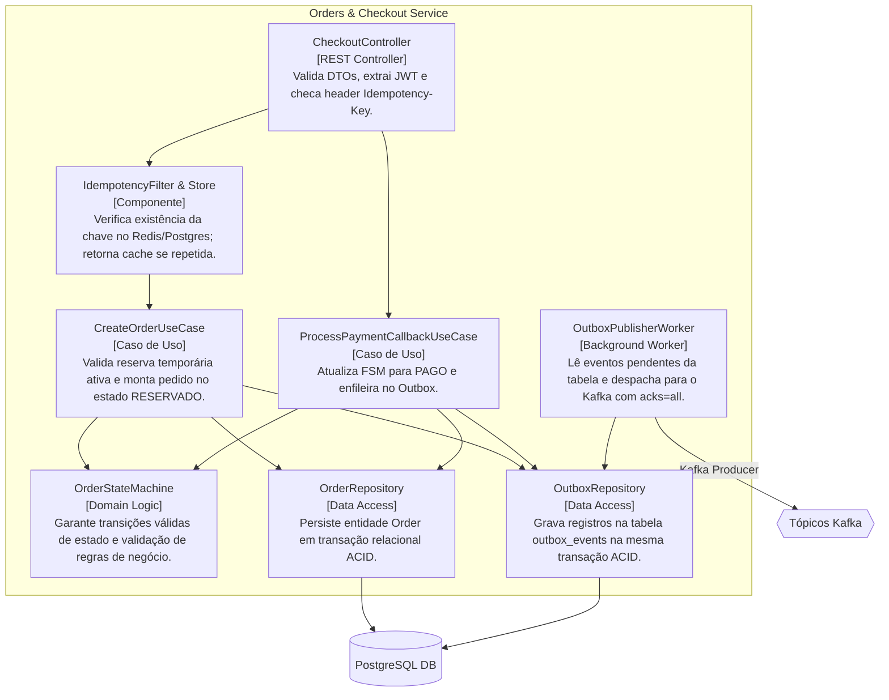
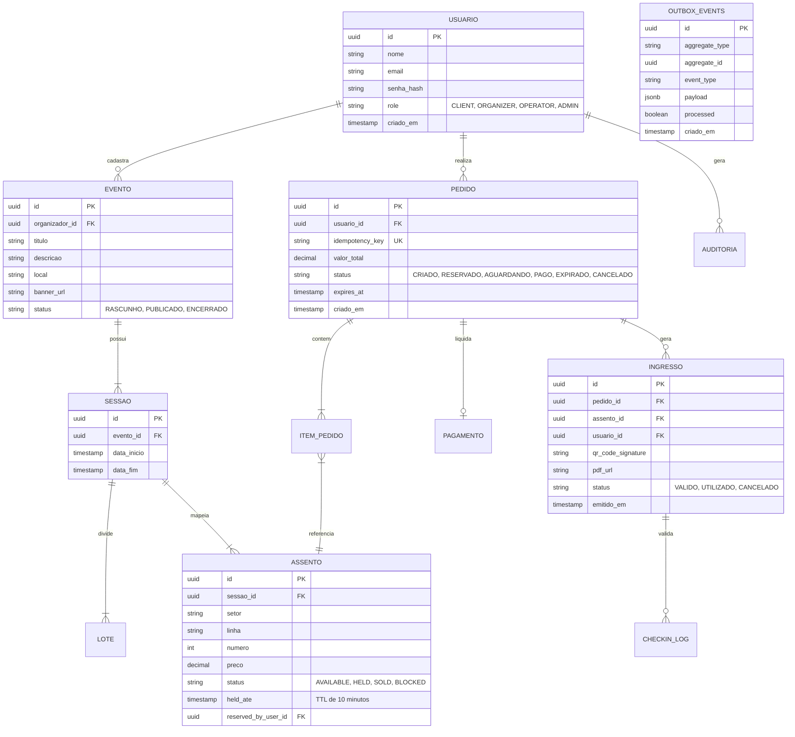
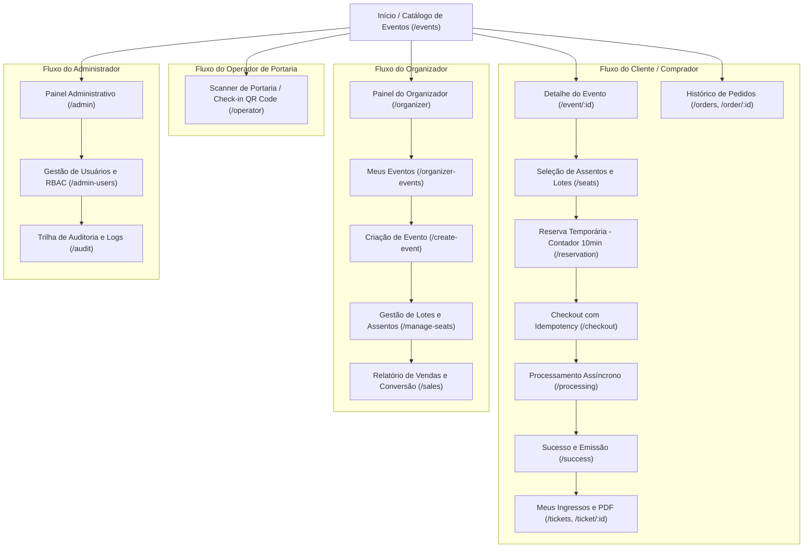
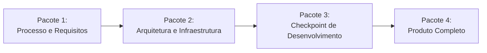

# Especificação Técnica do Projeto Integrador: PulsePass
**Disciplina:** Construção de Software – 2026/2  
**Instituição:** Pontifícia Universidade Católica do Rio Grande do Sul (PUCRS) – Escola Politécnica  
**Domínio:** Plataforma Distribuída de Bilhetagem, Reserva e Acesso para Megaeventos  

---

## 1. Visão Geral do Produto e Domínio de Negócio

### 1.1 Contexto e Justificativa
Sistemas transacionais convencionais estruturados exclusivamente em operações HTTP síncronas enfrentam graves falhas em cenários de alta concorrência:
- **Esgotamento de Connection Pools:** Dezenas de milhares de clientes disputando as mesmas conexões em bancos de dados relacionais causam saturação rápida do pool de conexões (RDBMS pool exhaustion).
- **Acoplamento Temporal:** A dependência síncrona de múltiplos nós (pagamento, reserva, validação, notificação) fragiliza a resiliência do sistema; a lentidão de um terceiro degrada em cascata a experiência do usuário.
- **Picos de Acesso em Rajada (*Flash Crowd Traffic*):** A abertura de vendas de megaeventos atrai dezenas de milhares de requisições simultâneas por segundo concentradas nos mesmos recursos (assentos disputados).

A plataforma **PulsePass** foi concebida para operar sob esse regime crítico, adotando arquitetura orientada a microsserviços e mensageria assíncrona, assegurando desacoplamento temporal, alta disponibilidade e integridade transacional absoluta.

### 1.2 Objetivos Centrais e Diretrizes Críticas
1. **Zero Overselling (Tolerância Zero a Sobre-Venda):** Nenhum assento ou ingresso pode ser vendido mais de uma vez, mesmo sob concorrência extrema de milissegundos.
2. **Expiração Estrita de Reservas Temporárias (TTL de 10 minutos):** Reservas temporárias concedidas no checkout possuem validade improrrogável de exatamente 10 minutos. Ao expirar o tempo sem pagamento confirmado, o assento é devolvido atomicamente ao catálogo.
3. **Desacoplamento e Resiliência via Kafka:** Operações não bloqueantes e isolamento de falhas por meio de streaming de eventos em tempo real.
4. **Idempotência Absoluta:** Garantia de eliminação de cobranças ou alocações duplicadas através de `Idempotency-Key` e consumidores de eventos idempotentes.
5. **Mitigação do Dual-Write Dilemma:** Aplicação mandatória do padrão *Transactional Outbox* para garantir que a escrita no banco relacional e o envio ao broker ocorram em consistência atômica.
6. **Emissão Segura e Antifraude:** Ingressos digitais emitidos em formato PDF contendo carimbo de tempo e QR Code assinado criptograficamente para validação instantânea no controle de acesso.

---

## 2. Escopo Funcional e Módulos do Sistema

O sistema é dividido em **cinco frentes funcionais autônomas**:

| Frente Funcional | Módulo / Domínio de Responsabilidade | Complexidade | Requisitos Funcionais Principais | Integração Técnica |
| :--- | :--- | :---: | :--- | :--- |
| **1. Identidade e Governança** | **IAM (Identity & Access Management)** | Média | • Autenticação stateless via JWT com refresh tokens em chave-valor (Redis/Keycloak).<br>• Autorização granular baseada em papéis (RBAC): *Cliente*, *Organizador*, *Operador* e *Admin*.<br>• Auditoria de credenciais e gestão cadastral de organizadores. | Provê segurança transversal, geração e validação de tokens criptográficos (JWKS) para todas as rotas e gateways. |
| **2. Inventário e Concorrência** | **Catálogo, Assentos e Bloqueio Concorrente** | Alta | • Criação de lotes e mapas de assentos (poltronas numeradas e setores de pista).<br>• Catálogo de eventos de altíssima taxa de leitura (*read-heavy*).<br>• Alocação atômica e temporária de assentos com lock distribuído.<br>• Devolução atômica em caso de cancelamento ou timeout (10 min). | Valida identidade com o IAM; emite locks concorrentes; despacha eventos de reserva e expiração para o Kafka. |
| **3. Transações e Checkout** | **Pedidos, Checkout e Transações Resilientes** | Alta | • Máquina de Estados Finitos (FSM) rigorosa do pedido.<br>• Suporte nativo a cabeçalho HTTP `Idempotency-Key`.<br>• Aplicação do padrão **Transactional Outbox** em transação ACID relacional.<br>• Integração com simulador de gateway financeiro. | Consome reservas do Inventário; integra webhook/simulador de pagamento; despacha eventos atômicos de checkout no Kafka. |
| **4. Mensageria e Despacho** | **Emissão de Ingressos, PDF e Notificações** | Média-Alta | • Consumo assíncrono de eventos de pagamentos confirmados.<br>• Geração de ingressos em PDF com carimbo de tempo e QR Code assinado.<br>• Disparo multicanal de comprovantes (e-mail, webhook) e atualização de tela em tempo real via WebSocket. | Monitora tópicos de pagamento concluído; emite ingressos e notifica o cliente via WebSocket/SSE. |
| **5. Análise e Operações** | **Telemetria, Analytics e DevOps** | Alta | • Ingestão e agregação contínua de eventos de navegação e compras.<br>• Painel analítico de métricas em tempo real (taxa de conversão, lotação de lotes, abandono de checkout).<br>• Orquestração unificada via Docker Compose e pipeline de CI/CD. | Consome tópicos de domínio da plataforma; agrega métricas operacionais e automatiza a governança e testes. |

---

## 3. Requisitos Detalhados por Módulo

### 3.1 Módulo 1: Identidade e Governança (IAM)
- **RF-IAM-01 (Autenticação Stateless):** Implementação de autenticação via tokens JWT assinados (RS256 ou EdDSA) acompanhados de *Refresh Tokens* com rotação persistidos em banco chave-valor com expiração estrita.
- **RF-IAM-02 (Controle de Acesso RBAC):** Aplicação de papéis estritos:
  - `ROLE_CLIENT`: Navega em eventos, reserva assentos, efetua checkout e acessa seus próprios ingressos.
  - `ROLE_ORGANIZER`: Cadastra e edita eventos, define lotes, precificação e mapas de assentos; visualiza relatórios de vendas dos seus eventos.
  - `ROLE_OPERATOR`: Acessa a interface de validação de acesso na portaria e executa check-in de ingressos via leitura de QR Code.
  - `ROLE_ADMIN`: Gestão global de usuários, bloqueio de contas suspeitas, auditoria de logs de segurança e telemetria completa.
- **RF-IAM-03 (Provedor de Identidade):** Integração com provedor centralizado de identidade (Keycloak ou AWS Cognito) ou serviço compatível com OpenID Connect (OIDC).
- **RF-IAM-04 (Trilha de Auditoria):** Registro imutável de eventos sensíveis de segurança (logins suspeitos, alterações de privilégios, concessão de perfis organizador/admin).

### 3.2 Módulo 2: Inventário, Catálogo e Concorrência
- **RF-INV-01 (Catálogo Read-Heavy):** Catálogo de eventos e sessões otimizado com cache de baixa latência (Redis), com estratégias de invalidação seletiva baseada em eventos de atualização de lote.
- **RF-INV-02 (Gestão de Assentos e Lotes):** Suporte a mapa de assentos numerados (linhas, colunas, setores) e lotes de capacidade geral (pista/arquibancada).
- **RF-INV-03 (Alocação Atômica e Lock Concorrente):**
  - Alocação garantida via travas atômicas distribuídas (ex.: Redis com scripts Lua / Redlock ou isolamento serializável em banco relacional).
  - Garantia estrita de que dois usuários simultâneos nunca consigam reservar o mesmo assento (*Zero Overselling*).
- **RF-INV-04 (Reserva Temporária com TTL):** O assento reservado entra no estado `HELD` com Time-To-Live de exatamente 10 minutos (600 segundos).
- **RF-INV-05 (Devolução Automática por Timeout):** Worker/agendador distribuído que, ao identificar a expiração do TTL de 10 minutos sem confirmação de pagamento, libera o assento imediatamente para `AVAILABLE` e publica o evento `reservation.expired` no Kafka.

### 3.3 Módulo 3: Pedidos, Checkout e Transações Resilientes
- **RF-CHK-01 (Máquina de Estados do Pedido):**
  ```mermaid
  stateDiagram-v2
      [*] --> CRIADO: Usuário inicia intenção de compra
      CRIADO --> RESERVADO: Assentos alocados com sucesso (TTL 10 min)
      RESERVADO --> AGUARDANDO_PAGAMENTO: Submetido ao gateway de pagamento
      AGUARDANDO_PAGAMENTO --> PAGO: Gateway confirma transação financeira
      AGUARDANDO_PAGAMENTO --> EXPIRADO: TTL 10 min esgotado sem confirmação
      RESERVADO --> EXPIRADO: Usuário não avançou em 10 min
      AGUARDANDO_PAGAMENTO --> CANCELADO: Pagamento recusado / cancelamento explícito
      PAGO --> [*]
      EXPIRADO --> [*]
      CANCELADO --> [*]
  ```
- **RF-CHK-02 (Idempotência via Cabeçalho):** O endpoint de checkout aceita e exige o cabeçalho HTTP `Idempotency-Key` (UUIDv4). Se o cliente reenviar a mesma requisição (ex.: falha de rede ou duplo clique), a resposta original idêntica é retornada sem reprocessar débito ou duplicação de pedido.
- **RF-CHK-03 (Transactional Outbox Pattern):**
  - Toda atualização de estado do pedido no PostgreSQL e o registro da mensagem de saída são gravados na **mesma transação ACID relacional**:
    ```sql
    BEGIN;
    UPDATE orders SET status = 'AGUARDANDO_PAGAMENTO' WHERE id = :orderId;
    INSERT INTO outbox_events (id, aggregate_type, aggregate_id, event_type, payload, created_at)
    VALUES (:eventId, 'ORDER', :orderId, 'OrderPaymentPending', :payload, NOW());
    COMMIT;
    ```
  - Um *Outbox Publisher Worker* (via CDC com Debezium ou polling assíncrono indexado) lê a tabela `outbox_events` e publica no Kafka com confirmação (`acks=all`), eliminando o problema do *Dual-Write*.
- **RF-CHK-04 (Simulador de Gateway Financeiro):** Componente com latência e cenários configuráveis (aprovação, recusa, timeout de rede e webhooks assíncronos) para validação integral do ciclo de checkout.

### 3.4 Módulo 4: Emissão de Ingressos, Mensageria e Despacho
- **RF-NOT-01 (Consumo Idempotente de Pagamento):** O microsserviço de emissão consome o tópico `orders.paid`. Cada mensagem processada é registrada em tabela de controle de idempotência de consumidor para evitar reprocessamento em caso de rebalanceamento do cluster Kafka.
- **RF-NOT-02 (Geração de Ingressos em PDF):**
  - Criação dinâmica de arquivo PDF contendo: dados do evento, data/hora, titular, setor/assento, valor, identificador do bilhete (*Ticket UUID*), carimbo de tempo oficial e QR Code seguro.
- **RF-NOT-03 (QR Code com Assinatura Criptográfica):**
  - O conteúdo do QR Code contém payload assinado com chave privada (HMAC-SHA256 ou chave assimétrica RSA/ECDSA) contendo `ticket_id`, `event_id`, `seat_id` e `timestamp`.
  - Permite validação instantânea na portaria tanto online quanto em modo de tolerância a partição de rede.
- **RF-NOT-04 (Notificação e WebSocket em Tempo Real):**
  - Notificação assíncrona por e-mail com comprovante em anexo.
  - Atualização automática da interface do usuário conectada via WebSocket assim que o pagamento for liquidado e o ingresso gerado.

### 3.5 Módulo 5: Telemetria, Analytics e Operações (DevOps)
- **RF-TEL-01 (Ingestão de Telemetria):** Coleta em tempo real de eventos de navegação, visualizações de eventos, funil de checkout e abandono de carrinho despachados para tópicos do Kafka.
- **RF-TEL-02 (Painel Analítico em Tempo Real):** Dashboard operacional exibindo:
  - Volume de requisições por segundo (RPS).
  - Vendas por minuto por evento.
  - Taxa de conversão do checkout e taxa de expiração de reservas (timeouts de 10 min).
  - Lotação percentual de setores em tempo real.
- **RF-TEL-03 (Painel de Operações / Portaria):** Visão operacional para a equipe de controle de acesso (total de ingressos validados, taxa de entrada por minuto e detecção de tentativas de reutilização de ingressos).

---

## 4. Requisitos Não-Funcionais (RNF)

| Identificador | Categoria | Descrição | Métrica / Critério de Aceite |
| :--- | :--- | :--- | :--- |
| **RNF-01** | **Consistência** | Prevenção absoluta de sobre-venda (*Zero Overselling*). | 0 duplicidades em testes de estresse concorrente sobre o mesmo assento. |
| **RNF-02** | **Concorrência e Vazão** | O sistema deve suportar rajadas súbitas (*flash crowds*) no catálogo e reservas. | Catálogo responde com latência p95 < 100ms sob carga; checkout com p95 < 500ms. |
| **RNF-03** | **Tolerância a Falhas e Resiliência** | Desacoplamento temporal e resiliência via Kafka e Circuit Breaker. | Falha temporária no gateway ou no serviço de PDF não trava a reserva nem gera inconsistência no banco de dados. |
| **RNF-04** | **Idempotência** | Todas as operações de pagamento e consumo de mensagens devem ser estritamente idempotentes. | Reenvio da mesma requisição HTTP ou reprocessamento de offset do Kafka não duplica débito nem bilhete. |
| **RNF-05** | **Tempo Real** | Expiração estrita de 10 minutos (600s) para reservas temporárias e atualização em tela. | Assentos não pagos liberados em no máximo 10min + 5s; atualização via WebSocket em < 1s após evento. |
| **RNF-06** | **Segurança** | Autenticação RBAC via JWT, comunicação TLS, criptografia de senhas e assinatura digital de QR Codes. | QR Code inviolável; proteção de rotas verificando escopos JWT em todas as APIs. |
| **RNF-07** | **Observabilidade** | Coleta centralizada de logs, métricas operacionais e rastreabilidade distribuída. | Rastreamento ponta a ponta com `Correlation-ID` propagado em headers HTTP e mensagens Kafka. |
| **RNF-08** | **Reprodutibilidade** | Toda a infraestrutura deve subir com um único comando. | Execução de `docker-compose up` inicializa backend, frontend, bancos, Redis, Kafka e UI. |

---

## 5. Arquitetura de Software no Modelo C4

### 5.1 C4 - Nível 1: Diagrama de Contexto de Sistema

O diagrama de contexto apresenta as fronteiras de software do **PulsePass**, seus atores humanos e os sistemas externos integrados:



---

### 5.2 C4 - Nível 2: Diagrama de Contêineres

O diagrama de contêineres detalha a divisão física de responsabilidades entre Single Page Application (SPA), Gateway, Microsserviços, bancos de dados, cache e streaming de mensageria:



---

### 5.3 C4 - Nível 3: Diagrama de Componentes (Orders & Checkout Service)

Estrutura interna representativa do serviço crítico de checkout, ilustrando o padrão Transactional Outbox, Casos de Uso, Idempotência e Publicação:



---

## 6. Arquitetura de Mensageria e Streaming com Kafka

### 6.1 Estrutura de Tópicos e Chaves de Particionamento
Para garantir ordenação causal estrita por entidade (agregado), todas as mensagens utilizam chaves de partição (*Partition Keys*) bem definidas:

| Tópico Kafka | Partition Key | Descrição do Evento | Produtor | Consumidores |
| :--- | :--- | :--- | :--- | :--- |
| `reservations.events` | `seat_id` / `event_id` | Eventos de assentos: `SeatReserved`, `ReservationExpired`, `SeatReleased`. | Catálogo / Inventário | Checkout Service, Analytics |
| `orders.events` | `order_id` | Transições de pedidos: `OrderCreated`, `OrderAwaitingPayment`, `OrderCancelled`. | Checkout Service (Outbox) | Analytics, WebSocket Gateway |
| `payments.events` | `order_id` | Confirmação ou falha de pagamento: `PaymentApproved`, `PaymentDeclined`. | Payment Simulator / Checkout | Checkout Service, Ticketing Service |
| `tickets.events` | `ticket_id` | Emissão e check-in: `TicketGenerated`, `TicketCheckedIn`. | Ticketing Service | Notification Service, WebSocket, Analytics |
| `telemetry.events` | `session_id` / `event_id` | Eventos analíticos: `PageView`, `SeatSelected`, `FunnelStep`. | Frontend Gateway | Analytics Service |

### 6.2 Prevenção do Dual-Write Dilemma
O dilema da escrita dupla ocorre quando uma aplicação precisa atualizar um banco de dados e notificar um broker de mensagens:
- Se salvar no banco e falhar antes de enviar ao Kafka, o evento é perdido.
- Se enviar ao Kafka primeiro e a transação no banco falhar, o sistema emite eventos fantasmas.

**Solução Obrigatória no Projeto:**
1. A gravação do pedido e o registro do evento de domínio na tabela `outbox_events` ocorrem na **mesma transação relacional PostgreSQL (`COMMIT` atômico)**.
2. O componente *Outbox Publisher Worker* consome a tabela `outbox_events` de forma assíncrona com garantia de entrega *at-least-once*.
3. Os consumidores de tópicos aplicam **tabela de idempotência de eventos** (*Event Deduplication* por `event_id`), garantindo semântica de processamento efetivamente única (*effectively-once processing*).

---

## 7. Modelo de Dados Conceitual



---

## 8. Processo de Desenvolvimento e Governança de Software (GCS)

### 8.1 Processo Suportado por IA
O ciclo de desenvolvimento do projeto é potencializado por agentes de Inteligência Artificial:
- **Papéis dos Agentes:**
  - *Arquitetura & Especificação:* Apoio na geração de modelos C4, especificações de endpoints OpenAPI/Swagger e schemas de mensageria.
  - *Geração & Refatoração de Código:* Geração assistida de classes de domínio, mapeamento ORM, migrations Flyway/Liquibase e consumers Kafka.
  - *Engenharia de Testes:* Geração automática de suites de testes unitários para a FSM do pedido e scripts de testes de integração com Testcontainers.
  - *Revisão de Código e Linting:* Agentes de PR review checando padrões de concorrência, idempotência e cobertura de código.
- **Rastreabilidade e Registro:** Registro explícito nos commits e documentação técnica das ferramentas, prompts e agentes utilizados durante o ciclo de desenvolvimento.

### 8.2 Gerenciamento da Configuração de Software (GCS)
- **Ferramenta de Controle de Versão:** Git hospedado no GitHub / GitLab.
- **Estratégia de Branching (Gitflow Adaptado):**
  - `main`: Código de produção estável, sempre deployável e versionado por tags semânticas (`v1.0.0`).
  - `develop`: Linha principal de integração contínua contendo as últimas features consolidadas.
  - `feature/<frente>-<nome>`: Branches de curta duração criadas a partir de `develop` para implementação de histórias específicas.
  - `hotfix/<descricao>`: Branches emergenciais criadas a partir de `main` para correção de bugs críticos em produção.
- **Políticas de Pull Request (Branch Protection):**
  - Merge bloqueado em `main` e `develop` sem aprovação de pelo menos 1 code reviewer.
  - Obrigatoriedade de passagem com sucesso em todas as etapas da pipeline de CI.
  - Não é permitido commits diretos nas branches protegidas.

### 8.3 Pirâmide de Testes Automatizados
```
        /  Testes de Carga   \      -> K6 / Locust (Simulação de Flash Crowd)
       /----------------------\
      / Testes de Integração   \    -> Testcontainers (PostgreSQL, Kafka, Redis)
     /--------------------------\
    /     Testes Unitários       \  -> JUnit / Vitest / Jest (FSM >= 70% cobertura)
   /------------------------------\
```
1. **Testes Unitários:**
   - Foco rigoroso nas máquinas de estado e regras de domínio (cálculo de descontos, expiração de prazos, validação de transições).
   - **Meta obrigatória:** $\ge 70\%$ de cobertura de código nos módulos de domínio.
2. **Testes de Integração:**
   - Uso de instâncias reais e efêmeras via **Testcontainers** para validação de:
     - Transações ACID reais no PostgreSQL;
     - Locks e expirações de chave no Redis;
     - Publicação e consumo de tópicos reais no Apache Kafka.
3. **Testes de Carga e Estresse (Bônus Recomendado):**
   - Roteiros em K6 simulando rajadas concorrentes disputando os mesmos assentos para demonstrar a ausência de *overselling*.

### 8.4 Pipeline de CI/CD (GitHub Actions / GitLab CI)
A cada Pull Request submetido para `develop` ou `main`, a esteira automatizada executa:
1. **Lint & Análise Estática:** Verificação de formatação e linters (oxlint/eslint, checkstyle/golangci-lint).
2. **Build & Compilação:** Compilação dos serviços backend e build estático do frontend.
3. **Testes Unitários:** Execução com validação da meta de cobertura mínima.
4. **Testes de Integração:** Subida de Testcontainers e validação de contratos e concorrência.
5. **Container Build & Docker Check:** Verificação da integridade das imagens Docker e do `docker-compose.yml`.

---

## 9. Mapeamento da Interface e Navegação do Frontend

O repositório já conta com protótipo de referência de alta fidelidade (`design-reference`) em React 19 + TypeScript + Tailwind CSS, contemplando todos os perfis de acesso:

### 9.1 Mapa de Navegação por Perfil



---

## 10. Estrutura de Pacotes e Entregáveis

O projeto é organizado e avaliado em **quatro pacotes cumulativos**:



### Pacote 1 – Processo de Desenvolvimento e Requisitos
- **Documento de Visão do Produto:** Justificativa de negócio, personas, proposição de valor e restrições.
- **Processo Suportado por IA:** Metodologia, catálogo de agentes, prompts adotados e ferramentas utilizadas no ciclo.
- **Backlog com Story Mapping:** Épicos funcionais desdobrados em Histórias de Usuário priorizadas por personas.
- **Especificação de Requisitos Não-Funcionais:** Critérios objetivos e métricas verificáveis.
- **Mockups e Mapa de Navegação:** Telas do sistema (baixa, média ou alta fidelidade) e diagrama completo de fluxos de telas.

### Pacote 2 – Arquitetura e Infraestrutura de Desenvolvimento
- **Arquitetura no Modelo C4:**
  - Nível 1: Contexto de Sistema (fronteiras, usuários e sistemas externos).
  - Nível 2: Contêineres (distribuição física, SPAs, APIs, RDBMS, Redis, Kafka).
  - Nível 3: Componentes (controladores, use cases, Outbox workers e consumidores).
- **Modelo de Dados Conceitual:** Diagrama entidade-relacionamento (DER) e definição de entidades de domínio.
- **Estrutura de Mensageria do Kafka:** Topologia de tópicos, schemas/eventos, partições e garantia de entrega.
- **Pipeline de Desenvolvimento CI/CD:** Desenho esquemático da esteira automatizada no GitHub Actions / GitLab CI.
- **Processo de GCS:** Regras de versionamento, fluxo de branching, regras de Pull Request e proteção de branch.

### Pacote 3 – Checkpoint do Desenvolvimento
- **Código-fonte em Estágio Corrente:** Link para o repositório com microsserviços integrados, persistência e mensageria funcional.
- **Documentação Atualizada:** Pacotes 1 e 2 revisados refletindo as decisões implementadas até o momento.

### Pacote 4 – Produto Completo
- **Entrega da Aplicação Completa:** Link para o repositório final com todos os 5 módulos funcionais e orquestração via `docker-compose.yml`.
- **Suíte de Testes Aprovada:** Testes unitários ($\ge 70\%$ cobertura da FSM) e testes de integração com Testcontainers em execução na CI.
- **Documentação Integral Atualizada:** Dossiê técnico completo contendo todas as especificações e instruções de execução.

---

## 11. Guia de Execução Local (Visão Prevista para o Ambiente)

A infraestrutura completa será instanciada via `docker-compose.yml`, englobando:
- Provedor de Identidade (Keycloak ou mock OIDC);
- Banco de dados relacional PostgreSQL (com bancos ou schemas isolados por serviço);
- Redis (cache, locks de assentos e expiração de 10 min);
- Apache Kafka (modo KRaft ou Zookeeper) e Kafka UI (gestão visual de tópicos e partições);
- Microsserviços de backend;
- Gateway de borda / WebSocket;
- Frontend SPA.

```bash
# Clone do repositório
git clone <url-do-repositorio>
cd projeto-integrador-de-construcao-de-software

# Inicialização de todos os serviços conteinerizados
docker compose up -d --build

# Acesso aos ambientes:
# Frontend SPA:          http://localhost:3000 ou http://localhost:8443
# Kafka UI:              http://localhost:8080
# Keycloak Admin:        http://localhost:8085
# API Gateway / Swagger: http://localhost:8000/docs
```
