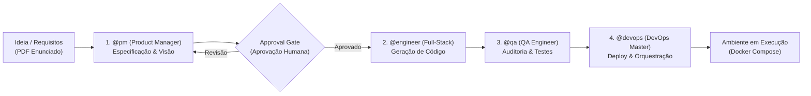
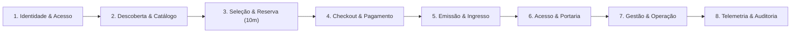
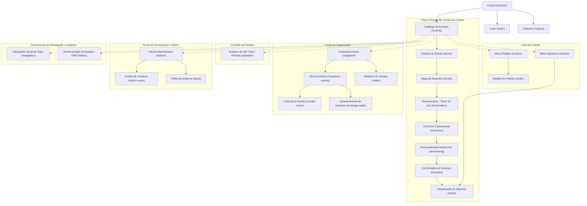
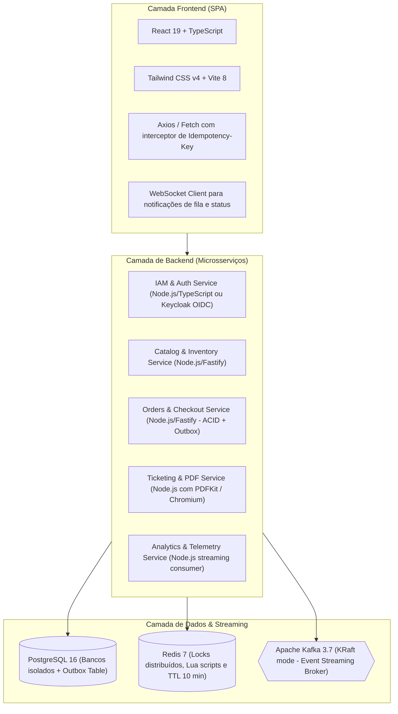
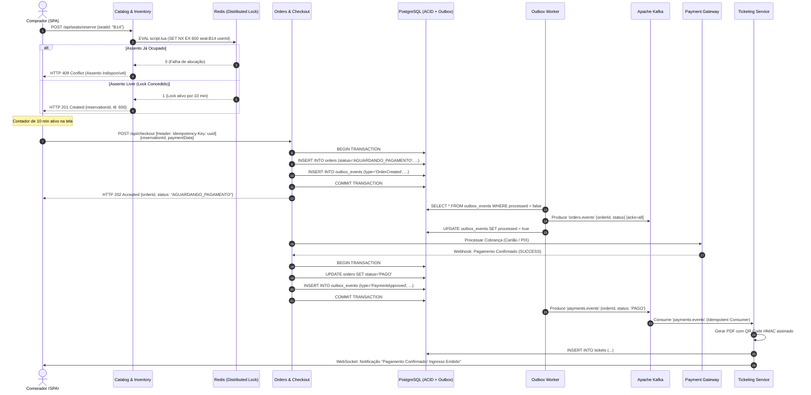

# Technical Specification & Pacote 1: PulsePass
**Documento de Especificação Técnica e Entregáveis do Pacote 1**  
**Projeto Integrador de Construção de Software – 2026/2**  
**Pontifícia Universidade Católica do Rio Grande do Sul (PUCRS) – Escola Politécnica**  
**Autor:** The Autonomous Development Team (@pm - Product Manager & Lead Architect)  
**Status:** Aguardando Aprovação do Usuário (Approval Gate)  

---

## Sumário Executivo (Executive Summary)

O **PulsePass** é uma plataforma distribuída de alta performance destinada à venda, reserva temporária e controle de acesso a megaeventos culturais e esportivos. O sistema foi projetado especificamente para solucionar os gargalos endêmicos de arquiteturas transacionais síncronas convencionais diante de picos de acesso em rajada (*flash crowd traffic*) no instante de abertura de vendas.

Sob tais condições extremas de concorrência, o PulsePass garante:
1. **Zero Overselling:** Tolerância zero à venda em duplicidade de um mesmo assento ou lote.
2. **Expiração Estrita de Reservas (TTL 10 min):** Garantia de devolução atômica de assentos ao catálogo em caso de não confirmação do pagamento em exatamente 10 minutos.
3. **Desacoplamento e Resiliência Assíncrona via Kafka:** Eliminação de gargalos de pools de conexão e quebra do acoplamento temporal via mensageria de streaming em tempo real.
4. **Idempotência Ponta a Ponta:** Eliminação de pagamentos duplicados via cabeçalho HTTP `Idempotency-Key` e consumidores Kafka com tabela de desduplicação.
5. **Mitigação do Dual-Write Dilemma:** Aplicação mandatória do padrão *Transactional Outbox* com garantias ACID no banco de dados relacional.
6. **Emissão Segura e Antifraude:** Emissão de ingressos em PDF com carimbo de tempo e QR Code criptograficamente assinado para validação online/offline de alta velocidade na portaria.

Este documento consolida integralmente os requisitos e entregáveis previstos para o **Pacote 1 – Processo de Desenvolvimento e Requisitos**, servindo simultaneamente como a especificação formal de engenharia para a equipe de desenvolvimento autônomo.

---

## 1. Descrição do Processo de Desenvolvimento Suportado por IA

Em consonância com as diretrizes da disciplina de Construção de Software (PUCRS 2026/2), o projeto adota um processo de engenharia assistido e acelerado por Inteligência Artificial (AI-Augmented Software Engineering).

### 1.1 Ciclo de Desenvolvimento (Pipeline Autônomo)
O ciclo é estruturado em quatro etapas iterativas coordenadas por papéis especializados:



1. **Fase 1 – Concepção e Especificação (@pm):** Tradução dos requisitos de negócios e restrições de arquitetura em especificações técnicas formais e histórias de usuário. Pausa obrigatória para revisão e aprovação do usuário.
2. **Fase 2 – Construção e Implementação (@engineer):** Scaffolding e codificação rigorosa baseada na especificação aprovada, mantendo fidelidade absoluta ao design de referência e às regras de negócio.
3. **Fase 3 – Qualidade e Auditoria (@qa):** Análise estática, testes unitários de máquinas de estado ($\ge 70\%$ de cobertura), validação de idempotência e auditoria de vulnerabilidades de segurança.
4. **Fase 4 – Infraestrutura e Orquestração (@devops):** Configuração de contêineres Docker, pipeline de CI/CD (GitHub Actions), provisionamento do Kafka/Redis/PostgreSQL e verificação da reprodutibilidade local.

### 1.2 Ferramentas e Ecossistema de IA
- **Agentes Especializados:** Agentes com atribuições segregadas (`@pm`, `@engineer`, `@qa`, `@devops`, `@firestore-rules-author`, `@flutter_a11y_agent`).
- **Engenharia de Prompts e Specs:** Especificações com sintaxe declarativa, critérios Gherkin e restrições de arquitetura limpa (Clean Architecture / Hexagonal).
- **Design Handoff com IA:** Prototipação rápida via **Figma Make** gerando componentes em React 19, TypeScript e Tailwind CSS v4, consolidada no diretório `design-reference`.
- **Governança e Rastreabilidade:** Todos os artefatos gerados contêm identificação do autor, referências aos requisitos originais e registro explícito das alterações aprovadas pelo desenvolvedor responsável.

---

## 2. Documento de Visão do Produto

### 2.1 Declaração de Posicionamento do Produto
- **Para:** Produtoras de entretenimento e organizadores de megaeventos (shows em estádios, festivais, convenções esportivas).
- **Que:** Enfrentam quedas constantes de infraestrutura, filas virtuais opacas e prejuízos causados por venda em duplicidade de ingressos disputados em segundos.
- **O PulsePass:** É uma plataforma distribuída de bilhetagem eletrônica, reserva concorrente e validação de acessos.
- **Que oferece:** Capacidade de absorção de tráfego em rajada com consistência de dados estrita, devolução automática de assentos após 10 minutos, desacoplamento por streaming Kafka e emissão de ingressos com QR Codes criptograficamente invioláveis.
- **Diferente de:** Plataformas transacionais legadas monolíticas e síncronas que sofrem com esgotamento de pools de conexão e lentidão generalizada.
- **Nosso Produto:** Combina persistência relacional com locks distribuídos em memória, arquitetura orientada a eventos e padrão Outbox garantindo zero sobre-venda e disponibilidade contínua.

### 2.2 Stakeholders e Personas

#### Persona 1: Alice Silva (Compradora / Fã de Música)
- **Perfil:** 26 anos, usuária assídua de plataformas digitais, compra ingressos no minuto exato da abertura de vendas.
- **Necessidades:** Garantia de que o assento selecionado fique reservado com exclusividade enquanto ela digita os dados de pagamento; clareza sobre o tempo restante (contador de 10 min); recebimento rápido do ingresso no smartphone.
- **Dores:** Perder o assento durante o preenchimento do formulário; cobrança dupla no cartão por clique repetido; receber ingressos falsificados.

#### Persona 2: Marcos Valente (Organizador do Evento)
- **Perfil:** 42 anos, gestor de operações de grandes festivais de música.
- **Necessidades:** Configurar mapas de assentos complexos e lotes de pista; acompanhar em tempo real o volume de vendas e taxa de conversão; ter garantia de que não haverá mais ingressos vendidos do que a lotação permitida por lei.
- **Dores:** Reclamações de consumidores no Procon por cancelamentos indevidos; relatórios financeiros desatualizados durante a abertura de vendas.

#### Persona 3: Rafael Souza (Operador de Portaria / Acesso)
- **Perfil:** 30 anos, responsável pelo controle de catracas e leitura de ingressos na entrada de estádios.
- **Necessidades:** Validação ultra-rápida (< 300ms) de QR Codes; leitura confiável mesmo em caso de instabilidade pontual da internet no estádio; detecção instantânea de ingressos já utilizados ou clonados.
- **Dores:** Filas quilométricas por lentidão no leitor; ingressos falsificados com print de tela.

#### Persona 4: Juliana Mendes (Administradora da Plataforma)
- **Perfil:** 35 anos, engenheira de operações e governança da plataforma.
- **Necessidades:** Visibilidade completa de telemetria, logs de auditoria de credenciais, gestão granular de papéis (RBAC) e status operacional de microsserviços.
- **Dores:** Falta de rastreabilidade sobre quem alterou permissões ou concedeu privilégios a terceiros.

---

## 3. Backlog de Produto e Story Mapping

### 3.1 Linha de Espinha Dorsal (Story Mapping Backbone)



### 3.2 Épicos e Histórias de Usuário Detalhadas

#### ÉPICO 1: Identidade, Autenticação e Governança (IAM)
* **US01 - Autenticação Stateless com JWT e Refresh Token**
  * *Como* usuário da plataforma (cliente, organizador, operador, admin),  
  * *Quero* realizar login seguro utilizando minhas credenciais e receber um token JWT stateless com refresh token persistido em chave-valor,  
  * *Para que* eu possa interagir com as APIs protegidas sem acoplamento de sessão em memória do servidor.
  * **Critérios de Aceite:**
    - O token JWT deve expirar em 15 minutos e conter claims de identificação (`sub`, `email`, `role`).
    - O refresh token deve ser mantido no Redis com expiração de 7 dias e suporte a revogação explícita.
    - Tentativa de acesso com token expirado retorna HTTP 401 Unauthorized.

* **US02 - Autorização Granular RBAC**
  * *Como* administrador do sistema,  
  * *Quero* que o sistema aplique controle de acesso estrito baseado nos perfis `CLIENT`, `ORGANIZER`, `OPERATOR` e `ADMIN`,  
  * *Para que* usuários não autorizados não acessem rotas administrativas ou de portaria.
  * **Critérios de Aceite:**
    - Rotas de `/api/organizer/*` exigem role `ORGANIZER` ou `ADMIN`.
    - Rotas de `/api/checkin/*` exigem role `OPERATOR` ou `ADMIN`.
    - Requisições sem a role necessária retornam HTTP 403 Forbidden.

* **US03 - Trilha de Auditoria de Credenciais e Organizadores**
  * *Como* auditor de segurança,  
  * *Quero* registrar todas as alterações de perfil, cadastros de organizadores e concessões de privilégios,  
  * *Para que* haja rastreabilidade completa em caso de incidentes.
  * **Critérios de Aceite:**
    - Registros imutáveis com timestamp UTC, ID do solicitante, IP de origem e payload modificado.

---

#### ÉPICO 2: Catálogo de Eventos e Alta Taxa de Leitura
* **US04 - Catálogo de Eventos Otimizado com Cache**
  * *Como* comprador,  
  * *Quero* listar e buscar eventos com baixa latência, mesmo durante abertura de vendas de grande impacto,  
  * *Para que* eu navegue sem lentidão ou erros de timeout.
  * **Critérios de Aceite:**
    - Consultas de catálogo devem ser servidas por cache Redis com latência p95 < 100ms.
    - O cache é invalidado seletivamente quando um evento for editado pelo organizador.

* **US05 - Detalhes do Evento, Lotes e Sessões**
  * *Como* comprador,  
  * *Quero* visualizar informações detalhadas do evento, datas, local e tipos de setores disponíveis,  
  * *Para que* eu decida quais assentos ou lotes desejo selecionar.
  * **Critérios de Aceite:**
    - Exibe disponibilidade agregada (ex.: "Esgotado", "Últimos ingressos", "Disponível").

---

#### ÉPICO 3: Mapa de Assentos, Alocação Concorrente e Expiração Estrita (10 min)
* **US06 - Visualização do Mapa de Assentos em Tempo Real**
  * *Como* comprador,  
  * *Quero* visualizar a planta de assentos do local organizada por setores, fileiras e números com status visual de cada poltrona,  
  * *Para que* eu escolha assentos específicos com meus amigos.
  * **Critérios de Aceite:**
    - Cores padronizadas: Verde (Disponível), Âmbar (Reservado temporariamente), Cinza (Vendido), Azul (Selecionado), Vermelho (Bloqueado).
    - Status atualizado em tempo real.

* **US07 - Alocação Atômica de Assentos (Zero Overselling)**
  * *Como* comprador,  
  * *Quero* selecionar um assento disponível e garantir que ele fique bloqueado exclusivamente para mim,  
  * *Para que* nenhuma outra pessoa consiga reservar a mesma poltrona concorrentemente.
  * **Critérios de Aceite:**
    - A alocação deve executar operação atômica (script Lua no Redis ou transação serializável).
    - Se dois usuários submeterem a reserva do mesmo assento no mesmo milissegundo, exatamente um obtém sucesso (HTTP 201) e o outro recebe HTTP 409 Conflict ("Assento não mais disponível").

* **US08 - Cronômetro de Reserva e Expiração Estrita de 10 Minutos**
  * *Como* comprador com assento reservado,  
  * *Quero* dispor de um prazo improrrogável de exatamente 10 minutos (600s) com contador regressivo visível na tela para concluir o pagamento,  
  * *Para que* eu tenha tempo de preencher meus dados sem pressa excessiva.
  * **Critérios de Aceite:**
    - O backend define o TTL da chave de reserva no Redis em 600 segundos.
    - Um worker monitora o vencimento das reservas.
    - Ao expirar o tempo sem pagamento confirmado, o status do assento volta automaticamente para `AVAILABLE`, e o evento `reservation.expired` é publicado no Kafka.
    - Na tela do comprador, um modal informativo alerta que a reserva expirou e redireciona para a seleção de assentos.

---

#### ÉPICO 4: Checkout Resiliente, Idempotência e Transações
* **US09 - Submissão de Pedido com Idempotency-Key**
  * *Como* comprador na tela de pagamento,  
  * *Quero* efetuar o pagamento informando cartão ou PIX com garantia de que reenvios acidentais não gerem cobrança dupla,  
  * *Para que* eu não seja tarifado duas vezes em caso de lentidão ou duplo clique.
  * **Critérios de Aceite:**
    - A requisição exige o cabeçalho `Idempotency-Key: <UUID>`.
    - Se a mesma chave for recebida dentro da janela de 24 horas, o sistema retorna o resultado original armazenado sem reprocessar a cobrança.

* **US10 - Publicação Garantida via Transactional Outbox Pattern**
  * *Como* arquiteto de software,  
  * *Quero* que a transição de estado do pedido e a emissão do evento para o broker ocorram na mesma transação ACID relacional,  
  * *Para que* o sistema não sofra com o dilema da escrita dupla (Dual-Write Dilemma).
  * **Critérios de Aceite:**
    - O comando `INSERT` na tabela `outbox_events` ocorre na mesma transação `COMMIT` do pedido.
    - Um worker assíncrono consome a tabela `outbox_events` e publica no tópico `orders.events` do Kafka com confirmação `acks=all`.

* **US11 - Integração com Simulador de Gateway Financeiro**
  * *Como* equipe de desenvolvimento e testes,  
  * *Quero* integrar um simulador de gateway de pagamentos com respostas configuráveis (aprovação instantânea, recusa, webhook assíncrono e simulação de timeout),  
  * *Para que* possamos validar cenários normais e de exceção de ponta a ponta.
  * **Critérios de Aceite:**
    - Suporte a webhooks de notificação de pagamento assíncrono.
    - Atualização da máquina de estados do pedido para `PAGO` ou `CANCELADO`.

---

#### ÉPICO 5: Emissão de Ingressos, PDF, QR Code Criptografado e Notificações
* **US12 - Geração de Ingresso em PDF com Carimbo de Tempo**
  * *Como* comprador com pagamento confirmado,  
  * *Quero* baixar meu ingresso digital oficial em formato PDF contendo todos os dados do evento, setor, assento e carimbo de data/hora,  
  * *Para que* eu possa imprimi-lo ou armazená-lo em meu smartphone.
  * **Critérios de Aceite:**
    - O PDF deve conter identificador UUID único do ingresso, data e hora da transação, dados do titular e layout padronizado do evento.

* **US13 - QR Code com Assinatura Criptográfica Antifraude**
  * *Como* organizador do evento,  
  * *Quero* que cada ingresso contenha um QR Code gerado a partir de um payload assinado criptograficamente (HMAC ou chave assimétrica),  
  * *Para que* ingressos forjados ou alterados sejam sumariamente rejeitados.
  * **Critérios de Aceite:**
    - O payload contém `{ticketId, eventId, seatId, issuedAt, signature}`.
    - A assinatura é verificável instantaneamente pela chave pública/segredo do sistema.

* **US14 - Atualização em Tempo Real via WebSocket e Envio de E-mail**
  * *Como* comprador aguardando na tela de processamento,  
  * *Quero* que a interface atualize automaticamente para "Pagamento Aprovado" assim que a notificação for emitida,  
  * *Para que* eu não precise recarregar a página manualmente.
  * **Critérios de Aceite:**
    - Conexão WebSocket informa a mudança de status do pedido em menos de 1 segundo após o processamento do evento no Kafka.
    - Disparo de e-mail transacional contendo o ingresso e o link de acesso.

---

#### ÉPICO 6: Operação de Portaria e Validação de Acesso
* **US15 - Scanner de Validação de QR Code na Portaria**
  * *Como* operador de portaria,  
  * *Quero* utilizar a câmera do dispositivo ou leitor óptico para escanear ingressos,  
  * *Para que* o acesso seja liberado de forma ágil na catraca.
  * **Critérios de Aceite:**
    - Validação de assinatura em menos de 300ms.
    - Indicação visual e sonora imediata: Verde (Válido), Vermelho (Inválido ou Já Utilizado).
    - Tentativa de reutilização registra log de suspeita de fraude e bloqueia entrada.

---

#### ÉPICO 7: Gestão do Organizador (Eventos, Lotes e Relatórios)
* **US16 - Cadastro e Publicação de Eventos e Lotes**
  * *Como* organizador,  
  * *Quero* cadastrar novos eventos, datas, sessões, preços por setor e políticas de cancelamento,  
  * *Para que* os ingressos sejam disponibilizados para venda ao público.
  * **Critérios de Aceite:**
    - Upload de imagem de banner, definição de capacidade total e configuração de assentos numerados.

* **US17 - Relatório de Vendas e Ocupação em Tempo Real**
  * *Como* organizador,  
  * *Quero* visualizar métricas de faturamento bruto, ingressos vendidos por lote e taxa de ocupação,  
  * *Para que* eu tome decisões de abertura de novos lotes ou ações promocionais.
  * **Critérios de Aceite:**
    - Gráficos atualizados com visão por setor e histórico temporal.

---

#### ÉPICO 8: Telemetria, Analytics e Operações da Plataforma
* **US18 - Ingestão Contínua de Eventos de Navegação e Compras**
  * *Como* engenheiro de dados e operações,  
  * *Quero* coletar eventos de telemetria (pageviews, seleções de assento, abandono de checkout) no Kafka,  
  * *Para que* tenhamos visão analítica do funil de conversão.
  * **Critérios de Aceite:**
    - Despacho assíncrono para o tópico `telemetry.events` sem bloquear a navegação do cliente.

* **US19 - Painel Analítico em Tempo Real (Dashboard)**
  * *Como* administrador da plataforma,  
  * *Quero* monitorar a taxa de requisições por segundo (RPS), latência dos serviços e taxa de timeouts de reservas,  
  * *Para que* eu garanta a integridade operacional da infraestrutura.
  * **Critérios de Aceite:**
    - Painel com atualização contínua e visualização de alertas operacionais.

---

## 4. Requisitos Não-Funcionais (RNF)

| ID | Categoria | Declaração Formal | Métrica / Critério de Aceite |
| :--- | :--- | :--- | :--- |
| **RNF-01** | **Consistência de Dados** | O sistema não deve permitir sobre-venda (*Zero Overselling*) em hipótese alguma. | 100% de consistência: em testes de estresse com 1.000 requisições simultâneas para o mesmo assento, exatamente 1 usuário obtém a reserva e 999 recebem recusa de conflito. |
| **RNF-02** | **Desempenho e Vazão** | O catálogo de eventos e a verificação de assentos devem responder em baixa latência sob regime de rajada (*flash crowd*). | Tempo de resposta p95 < 100ms para consultas de catálogo em cache; p95 < 500ms para o endpoint de reserva sob 2.000 RPS. |
| **RNF-03** | **Resiliência e Desacoplamento** | A indisponibilidade de serviços terceiros (gateways financeiros, disparo de emails) não deve interromper a integridade de reservas nem bloquear o catálogo. | Adoção do Apache Kafka como backbone assíncrono com retenção durável e Circuit Breakers nas integrações externas. |
| **RNF-04** | **Idempotência Transacional** | Todas as operações de checkout e consumo de eventos devem ser estritamente idempotentes. | Reenvio da mesma requisição HTTP com o mesmo `Idempotency-Key` ou reprocessamento de mensagens Kafka produz exatamente o mesmo resultado sem efeitos colaterais. |
| **RNF-05** | **Controle Temporal (TTL)** | As reservas temporárias devem expirar estritamente em 10 minutos (600s), liberando o assento de forma atômica. | Assentos não pagos retornam ao estado `AVAILABLE` em no máximo 10 minutos + 5 segundos da reserva inicial. |
| **RNF-06** | **Segurança e Criptografia** | Autenticação stateless baseada em JWT com assinatura criptográfica (RS256); controle de acesso RBAC; QR Codes com HMAC-SHA256. | Impossibilidade matemática de forjar QR Codes sem a chave secreta; proteção mandatória em 100% das rotas privadas. |
| **RNF-07** | **Observabilidade** | Logs estruturados em formato JSON com propagação do cabeçalho `Correlation-ID` em todas as chamadas HTTP e mensagens Kafka. | Rastreabilidade distribuída completa de cada transação desde o clique do cliente até a emissão do ingresso. |
| **RNF-08** | **Reprodutibilidade DevOps** | A infraestrutura completa de microsserviços, bancos e mensageria deve ser inicializável com um único comando local. | `docker compose up -d` inicializa 100% do ecossistema localmente sem dependências externas adicionais instaladas na máquina host. |

---

## 5. Mockups e Mapa de Navegação do Front-End

O design do sistema foi integralmente prototipado no **Figma Make** e está consubstanciado no código-fonte de alta fidelidade contido no diretório `design-reference`.

### 5.1 Diagrama do Mapa de Navegação Completo



---

### 5.2 Especificação dos Mockups e Componentes Chave

#### 5.2.1 Tela 1: Catálogo de Eventos (`/events`)
- **Objetivo:** Exibir os megaeventos em destaque com busca instantânea, filtros por categoria (Música, Festivais, Esporte, Teatro) e indicadores de lotação.
- **Wireframe Estrutural:**
```
+-----------------------------------------------------------------------------------+
|  [P] PulsePass    [ Buscar eventos, artistas, cidades... ]      (Meus Ingressos) (Perfil) |
+-----------------------------------------------------------------------------------+
|  BANNER: THE MIDNIGHT TOUR 2026 - ABERTURA DE VENDAS [Comprar Ingressos]          |
+-----------------------------------------------------------------------------------+
|  Categorias: [Todos] [Shows] [Festivais] [Esportes] [Teatro]                     |
|                                                                                   |
|  +--------------------+  +--------------------+  +--------------------+           |
|  | [ IMAGEM SHOW 1 ]  |  | [ IMAGEM FESTIVAL] |  | [ IMAGEM ESTÁDIO ] |           |
|  | Rock in Pulse 2026 |  | Electronic Night   |  | Grande Final Copa  |           |
|  | Porto Alegre, RS   |  | São Paulo, SP      |  | Rio de Janeiro, RJ |           |
|  | A partir de R$ 180 |  | A partir de R$ 220 |  | A partir de R$ 150 |           |
|  | [Ver Assentos ->]  |  | [Ver Assentos ->]  |  | [Ver Assentos ->]  |           |
|  +--------------------+  +--------------------+  +--------------------+           |
+-----------------------------------------------------------------------------------+
```

#### 5.2.2 Tela 2: Mapa Interativo de Assentos (`/seats`)
- **Objetivo:** Renderização vetorial dos setores e mapa matricial de assentos (Linhas A a F, Colunas 1 a 18).
- **Legenda de Estados:**
  - 🟢 **Disponível (Verde):** Assento livre para reserva atômica.
  - 🟡 **Reservado (Âmbar):** Em posse temporária de outro usuário (TTL ativo).
  - ⚪ **Vendido (Cinza Escuro):** Ingresso liquidado e indisponível.
  - 🔵 **Selecionado (Azul):** Escolhido pelo usuário corrente.
  - 🔴 **Bloqueado (Vermelho):** Retido pela produção do evento.
- **Wireframe Estrutural:**
```
+-----------------------------------------------------------------------------------+
|  <- Voltar    The Midnight Tour 2026 - Arena Pulse                                |
+-----------------------------------------------------------------------------------+
|                              PALCO / STAGE PRINCIPAL                              |
|   =============================================================================   |
|                                                                                   |
|   A  [1] [2] [3] [4] [5] [6] [7] [8] [9][10][11][12][13][14][15][16][17][18]      |
|   B  [1] [2] [3] [4] [5] [6] [7] [8] [9][10][11][12][13][14][15][16][17][18]      |
|   C  [1] [2] [3] [4] [5] [6] [7] [8] [9][10][11][12][13][14][15][16][17][18]      |
|   D  [1] [2] [3] [4] [5] [6] [7] [8] [9][10][11][12][13][14][15][16][17][18]      |
|   E  [1] [2] [3] [4] [5] [6] [7] [8] [9][10][11][12][13][14][15][16][17][18]      |
|   F  [1] [2] [3] [4] [5] [6] [7] [8] [9][10][11][12][13][14][15][16][17][18]      |
|                                                                                   |
|   Legenda: (o) Disponível  (x) Reservado  (#) Vendido  [*] Selecionado  (!) Bloq  |
+-----------------------------------------------------------------------------------+
|   Assento Selecionado: B14 (Setor Premium A) | Valor: R$ 320,00                   |
|   [ RESERVAR ASSENTO (Inicia TTL 10 min) -> ]                                     |
+-----------------------------------------------------------------------------------+
```

#### 5.2.3 Tela 3: Reserva Temporária com Timer Regressivo (`/reservation`)
- **Objetivo:** Exibir a confirmação do bloqueio temporário exclusivo e contador visível com contagem decrescente estrita de 10 minutos (600 segundos).
- **Wireframe Estrutural:**
```
+-----------------------------------------------------------------------------------+
|                           SUA RESERVA ESTÁ GARANTIDA!                             |
|                                                                                   |
|               +---------------------------------------------------+               |
|               |        TEMPO RESTANTE PARA CONCLUIR COMPRA:       |               |
|               |                     [ 09:42 ]                     |               |
|               |  Seu assento está seguro. Conclua antes que expire|               |
|               +---------------------------------------------------+               |
|                                                                                   |
|   Resumo da Reserva:                                                              |
|   • Evento: The Midnight Tour 2026                                                |
|   • Local: Arena Pulse - Porto Alegre, RS                                         |
|   • Assento: B14 (Setor Premium Central)                                          |
|   • Valor: R$ 320,00 + Taxa de Serviço R$ 32,00 = Total R$ 352,00                 |
|                                                                                   |
|   [ Cancelar Reserva e Liberar Assento ]        [ AVANÇAR PARA PAGAMENTO -> ]     |
+-----------------------------------------------------------------------------------+
```

#### 5.2.4 Tela 4: Checkout com Proteção de Idempotência (`/checkout`)
- **Objetivo:** Formulário de pagamento (Cartão ou PIX) enviando automaticamente o cabeçalho `Idempotency-Key` gerado no frontend para evitar duplicações.
- **Wireframe Estrutural:**
```
+-----------------------------------------------------------------------------------+
|  <- Voltar para Reserva                      Tempo Restante: [ 08:15 ]            |
|  CHECKOUT SEGURO - PULSEPASS                                                      |
+-----------------------------------------------------------------------------------+
|  Forma de Pagamento:  (o) Cartão de Crédito    ( ) PIX Instantâneo                |
|                                                                                   |
|  [ Número do Cartão: 4532 •••• •••• 8891 ]                                        |
|  [ Nome Impresso no Cartão: ALICE M SILVA ]                                       |
|  [ Validade: 08/29 ]   [ CVV: 821 ]    [ Parcelas: 1x de R$ 352,00 sem juros ]    |
|                                                                                   |
|  Cabeçalho de Segurança Ativo: Idempotency-Key = 9f4a21e0-82a1-4f11-b2...         |
|                                                                                   |
|  [ FINALIZAR COMPRA SEGURA (R$ 352,00) ]                                          |
+-----------------------------------------------------------------------------------+
```

#### 5.2.5 Tela 5: Emissão de Ingresso Digital com QR Code (`/ticket`)
- **Objetivo:** Exibição do ingresso digital com QR Code seguro assinado e botão de download do PDF oficial com carimbo de tempo.
- **Wireframe Estrutural:**
```
+-----------------------------------------------------------------------------------+
|  PULSEPASS DIGITAL PASS                                            STATUS: VÁLIDO |
+-----------------------------------------------------------------------------------+
|  THE MIDNIGHT TOUR 2026                                                           |
|  Data: 14 de Novembro de 2026 às 21:00                                            |
|  Local: Arena Pulse - Porto Alegre, RS                                            |
|  Titular: ALICE M SILVA (Doc: ***.418.990-**)                                     |
|  Setor: Premium Central | Assento: B14                                            |
|                                                                                   |
|                       +-------------------------------+                           |
|                       |  [QR CODE CRIPTOGRAFADO]      |                           |
|                       |  HMAC-SHA256 Assinado         |                           |
|                       |  Hash: a7f8...9c12            |                           |
|                       +-------------------------------+                           |
|                                                                                   |
|  Carimbo de Tempo: 2026-10-08T23:51:12.418Z | Ticket UUID: 8bc2...                |
|                                                                                   |
|  [ BAIXAR INGRESSO EM PDF ]                   [ ADICIONAR À CARTEIRA DIGITAL ]    |
+-----------------------------------------------------------------------------------+
```

#### 5.2.6 Tela 6: Scanner do Operador de Portaria (`/operator`)
- **Objetivo:** Interface de alta velocidade para operadores de catraca com leitor óptico e validação instantânea.
- **Wireframe Estrutural:**
```
+-----------------------------------------------------------------------------------+
|  PULSEPASS - CONTROLE DE ACESSO PORTARIA               OPERADOR: RAFAEL SOUZA     |
+-----------------------------------------------------------------------------------+
|  Evento: The Midnight Tour 2026 | Portão: 04 - Entrada Leste                      |
|                                                                                   |
|  [ MIRA DO SCANNER / LEITOR DE QR CODE ATIVO ]                                    |
|                                                                                   |
|  STATUS DA ÚLTIMA LEITURA:                                                        |
|  +-----------------------------------------------------------------------------+  |
|  |  [ V ] ACESSO LIBERADO! (240ms)                                             |  |
|  |  Ingresso: 8bc2-11a | Titular: ALICE M SILVA | Assento: B14                 |  |
|  +-----------------------------------------------------------------------------+  |
|                                                                                   |
|  Total Validados Hoje: 1.482 ingressos | Ingressos Rejeitados: 3                  |
+-----------------------------------------------------------------------------------+
```

---

## 6. Arquitetura de Software e Tech Stack Recomendada

Com base nos requisitos mandatórios de alta concorrência, consistência relacional ACID com Outbox, streaming distribuído e interface rica, a seguinte pilha tecnológica de ponta foi selecionada:

### 6.1 Visão Geral do Tech Stack



1. **Frontend:**
   - **Framework:** React 19 + TypeScript 5.7.
   - **Build Tool:** Vite 8.
   - **Estilização:** Tailwind CSS v4 (`@tailwindcss/vite`).
   - **Reuso de Design:** Base construída e validada em `design-reference` (24 telas e componentes modulares).
2. **Backend (Microsserviços Poliglotas/Node.js TypeScript):**
   - **Runtime:** Node.js 22 LTS / Fastify ou NestJS (altíssimo throughput de I/O assíncrono).
   - **Comunicação com Kafka:** `kafkajs` com suporte a partições, transações e commit manual de offsets.
   - **Comunicação com Redis:** `ioredis` com execução de scripts atômicos Lua para alocação com zero overselling.
   - **Persistência Relacional:** PostgreSQL 16 com ORM/Query Builder relacional (Prisma ou Kysely/TypeORM) com suporte nativo a transações ACID explícitas.
3. **Mensageria e Streaming:**
   - **Broker:** Apache Kafka em modo KRaft (sem dependência do Zookeeper).
   - **UI de Monitoramento:** Kafka UI (`provectuslabs/kafka-ui`) para inspeção de tópicos e partições em tempo real.
4. **DevOps e Testes:**
   - **Ambiente Local:** Docker Compose com todas as imagens e volumes pré-configurados.
   - **Testes Unitários:** Vitest / Jest com cobertura $\ge 70\%$ nos domínios da FSM do pedido.
   - **Testes de Integração:** **Testcontainers** instanciando contêineres reais de PostgreSQL, Redis e Kafka.
   - **CI/CD:** GitHub Actions configurado para lint, testes unitários, testes de integração e build de contêineres a cada Pull Request.

---

## 7. Mapeamento de Estados da FSM e Fluxo Transacional do Checkout



---

## 8. Checklist de Conformidade com o Pacote 1 (PUCRS 2026/2)

| Item Requisitado no Enunciado | Status no Documento | Seção de Referência |
| :--- | :---: | :--- |
| **Descrição do processo de desenvolvimento suportado por IA** | Concluído | [Seção 1](#1-descrição-do-processo-de-desenvolvimento-suportado-por-ia) |
| **Documento de Visão do Produto** | Concluído | [Seção 2](#2-documento-de-visão-do-produto) |
| **Backlog com Épicos e Histórias de Usuários (Story Mapping)** | Concluído | [Seção 3](#3-backlog-de-produto-e-story-mapping) |
| **Requisitos Não-Funcionais objetivos e mensuráveis** | Concluído | [Seção 4](#4-requisitos-não-funcionais-rnf) |
| **Mockups e Mapa de Navegação do Front-End (Design Reference)** | Concluído | [Seção 5](#5-mockups-e-mapa-de-navegação-do-front-end) |
| **Tech Stack, Arquitetura e Estrutura Transacional** | Concluído | [Seções 6 e 7](#6-arquitetura-de-software-e-tech-stack-recomendada) |

---

## 9. Próximos Passos (Transição para o Pacote 2 / Implementação)

Uma vez obtida a aprovação formal do usuário:
1. O `@engineer` iniciará a implementação física do código no diretório de construção (`app_build/`), estruturando os microsserviços, schemas do banco de dados e testes de integração com Testcontainers.
2. O `@qa` auditará a cobertura dos testes da FSM do pedido ($\ge 70\%$) e o tratamento de concorrência com Redis.
3. O `@devops` configurará o `docker-compose.yml` completo (PostgreSQL, Redis, Kafka KRaft, Kafka UI, APIs e Frontend SPA) e a pipeline do GitHub Actions.
