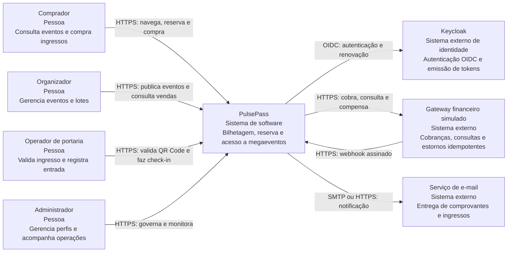
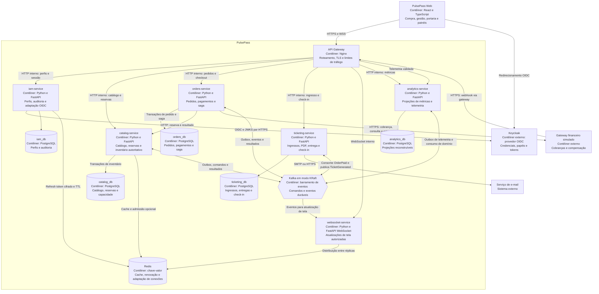
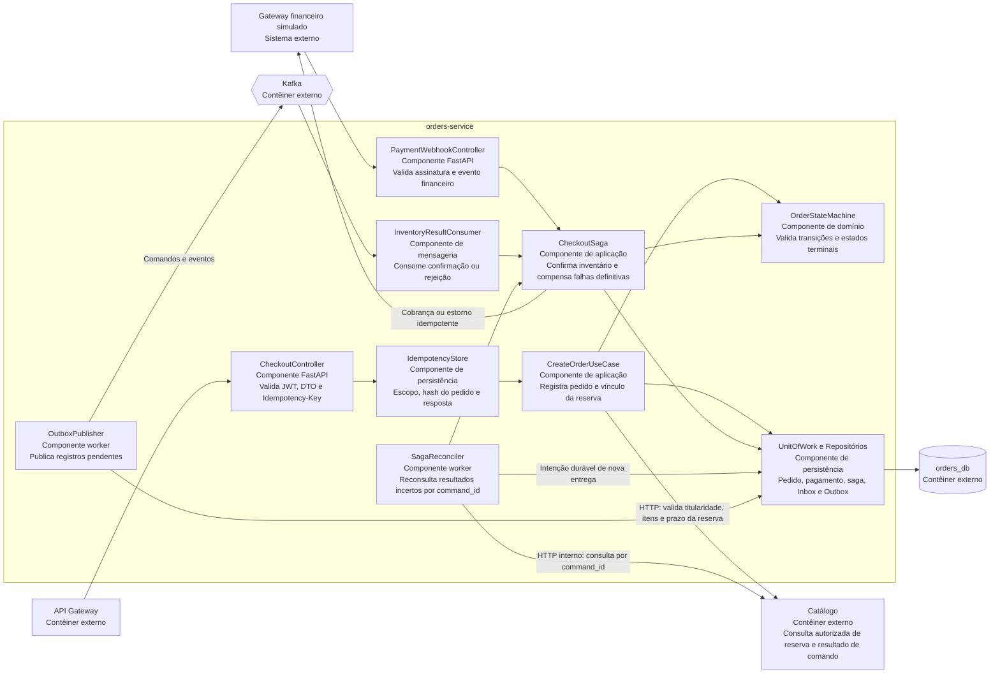
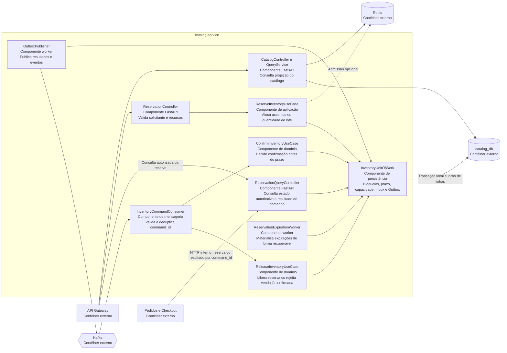
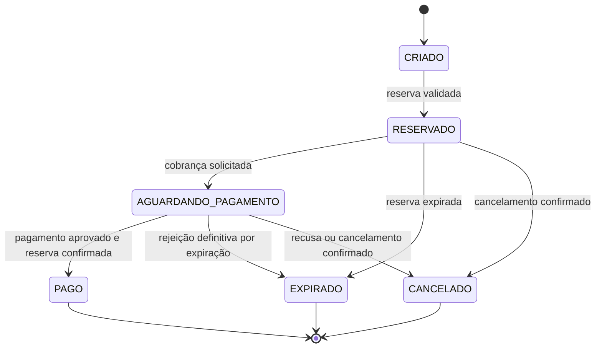
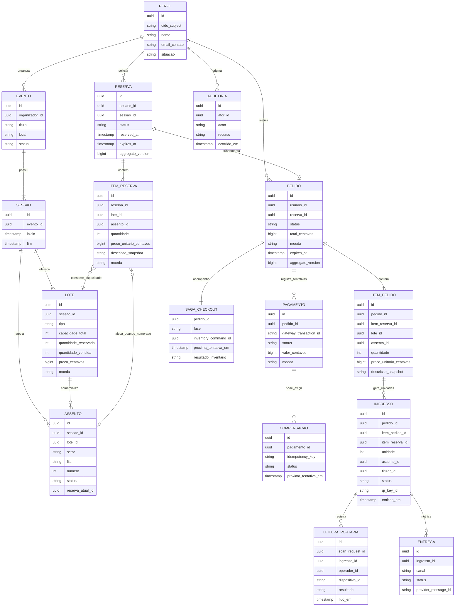
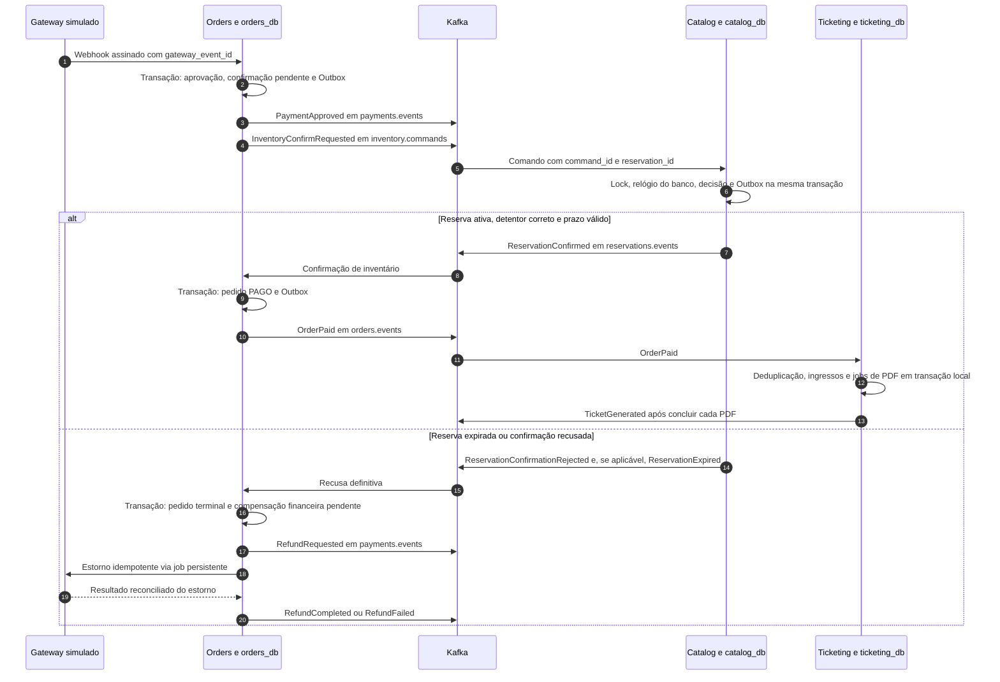
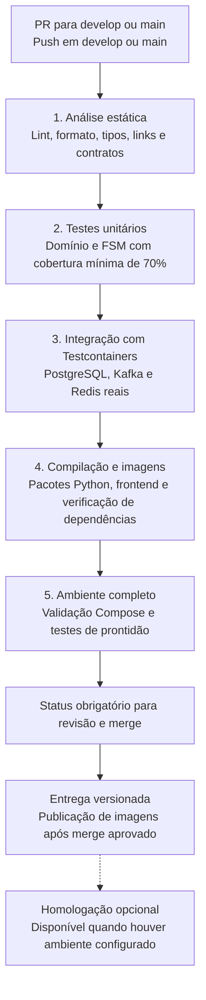
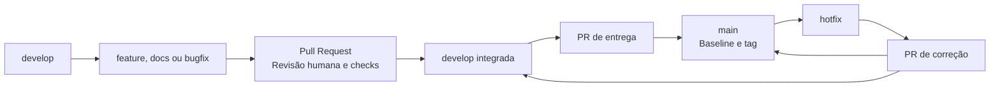

# Especificação técnica do Pacote 2 do PulsePass

**Projeto Integrador de Construção de Software 2026/2 — PUCRS, Escola Politécnica**
**Entrega:** Arquitetura e Infraestrutura de Desenvolvimento
**Revisão:** 28/10/2026
**Status:** Arquitetura aprovada em 28/10/2026; escopo atual restrito à documentação do Pacote 2

## Sumário executivo

O PulsePass é uma plataforma distribuída de bilhetagem, reserva e acesso para megaeventos. A arquitetura organiza identidade, inventário, pedidos, emissão de ingressos e análise operacional em serviços independentes. PostgreSQL mantém as decisões transacionais; Redis acelera consultas e mantém sessões de renovação; Kafka transporta comandos e eventos de domínio.

A reserva vale 600 segundos e não pode produzir venda duplicada. O Inventário arbitra confirmação e expiração em uma transação local. A confirmação financeira isolada não autoriza emissão: o evento `OrderPaid` representa pagamento confirmado **e** inventário confirmado. Cada serviço persiste suas alterações e seus eventos de saída na mesma transação, e os consumidores persistentes deduplicam mensagens antes de aplicar efeitos de negócio.

O pacote reúne os cinco entregáveis documentais do enunciado: C4, modelo conceitual de dados, estrutura Kafka, pipeline esquemática e processo de GCS. As seções 7 e 8 registram a stack aprovada e o plano de infraestrutura para implementação posterior. Os diagramas representam a arquitetura projetada; a aceitação documental e a evidência de funcionamento são registradas separadamente na seção 9.

O [README do Pacote 2](../docs/pacote-2/README.md) é o índice desta entrega. O [enunciado da disciplina](../Projeto_Final_Construcao_Software-2026-2.pdf), páginas 3–5, define as obrigações. A [especificação arquivada do Pacote 1](../docs/pacote-1/Technical_Specification_Pacote_1.md) preserva os requisitos e o processo de origem. Em decisões técnicas sobrepostas, esta revisão do Pacote 2 é a arquitetura aprovada; os exemplos anteriores, inclusive `orders.paid`, não definem novos contratos Kafka.

## 1. Requisitos do Sistema e Restrições de Engenharia

### 1.1 Escopo do Pacote 2 e origem dos requisitos

O Pacote 2 descreve a arquitetura C4 nos níveis 1, 2 e 3, o modelo de dados conceitual, a estrutura de mensageria Kafka, o desenho da pipeline de desenvolvimento e o processo de GCS. A implementação integrada é o checkpoint do Pacote 3; esta especificação define decisões e critérios que orientarão essa implementação.

Os requisitos obrigatórios abaixo vêm das páginas 1 a 4 do [enunciado da disciplina](../Projeto_Final_Construcao_Software-2026-2.pdf). As tecnologias específicas são decisões da equipe aprovadas neste pacote. As metas adicionais de desempenho dependem da definição e medição do cenário, como indicado na seção 1.3.

| ID | Requisito obrigatório do projeto | Responsabilidade principal |
| :--- | :--- | :--- |
| RF-01 | Autenticação stateless com JWT, refresh tokens em chave-valor, RBAC para Cliente, Organizador, Operador e Admin, auditoria e cadastro de organizadores | IAM e Keycloak |
| RF-02 | Catálogo, lotes e mapas de assentos; alocação e devolução atômicas; nenhuma venda acima da capacidade | Catálogo e Inventário |
| RF-03 | Reservas temporárias de 10 minutos; liberação em cancelamento ou expiração | Catálogo e Inventário |
| RF-04 | Máquina de estados do pedido: Criado, Reservado, Aguardando pagamento, Pago e Expirado; cabeçalho HTTP `Idempotency-Key` | Pedidos e Checkout |
| RF-05 | Atualização transacional do pedido e Outbox no mesmo banco relacional; integração com gateway financeiro simulado | Pedidos e Checkout |
| RF-06 | Emissão assíncrona de ingresso PDF com carimbo de tempo e QR Code após a compra confirmada; notificações e atualização de tela | Emissão e Despacho |
| RF-07 | Ingestão de eventos e painel de métricas em tempo real; orquestração Docker Compose e pipeline automatizada | Analytics e Operações |
| RA-01 | Microsserviços, provedor de identidade como Keycloak ou Cognito e Kafka como barramento de streaming | Todos os serviços |
| RA-02 | Tratamento do dilema da escrita dupla e de mensagens duplicadas | Todo produtor e consumidor com alteração de domínio |
| RT-01 | Testes unitários de máquinas de estado com pelo menos 70% de cobertura do domínio; integração com PostgreSQL e Kafka reais via Testcontainers, e Redis quando utilizado | Pipeline e equipe de desenvolvimento |

O estado adicional `CANCELADO` representa cancelamento explícito ou recusa definitiva. Confirmação de inventário e compensação financeira são fases explícitas da saga descrita na seção 2.4, preservando os estados centrais exigidos pelo enunciado.

### 1.2 Decisões aprovadas da equipe

| Decisão | Definição aprovada |
| :--- | :--- |
| Linguagem e framework de backend | Python 3.12 e FastAPI nos serviços, conforme preferência do responsável pelo projeto |
| Frontend e borda | SPA React com TypeScript, Tailwind e Vite; Nginx para roteamento e terminação TLS |
| Identidade | Keycloak como único emissor de tokens e responsável por credenciais; `iam-service` administra perfis de negócio, auditoria e a integração OIDC |
| Estado autoritativo do inventário | PostgreSQL do `catalog-service`; transações locais e bloqueios de linhas protegem assentos e capacidade dos lotes |
| Papel do Redis | Cache, sessões de renovação e otimização de admissão de reservas; falha ou expiração de uma chave Redis não autoriza uma venda |
| Comunicação entre domínios | HTTP para leitura e comandos interativos; Kafka para eventos e para as etapas duráveis da saga |
| Consistência entre serviços | Saga com compensação, Outbox e consumidores idempotentes; nenhuma transação ou chave estrangeira atravessa bancos de serviços |
| Portaria | Check-in online e atômico; leitura offline pode conferir a assinatura, mas não garante impedir o uso simultâneo em dispositivos desconectados |

### 1.3 Invariantes e critérios verificáveis

1. **Inventário:** um assento de uma sessão possui no máximo uma alocação válida. Para lotes de capacidade geral, `quantidade_reservada + quantidade_vendida <= capacidade_total`; ambos os contadores são não negativos.
2. **Prazo:** o Catálogo calcula `expires_at = reserved_at + 600 segundos` usando o relógio do seu banco. A reserva temporária é elegível à confirmação somente se estiver `ATIVA` e o instante de decisão no banco for estritamente anterior a `expires_at`. Uma reserva `CONFIRMADA` já representa venda e não expira pelo prazo temporário. Alterar telas, refazer checkout ou repetir um comando não reinicia o prazo.
3. **Expiração:** nenhuma confirmação é aceita a partir do prazo. A persistência da transição, o ajuste de contadores, a publicação do evento e a atualização das telas podem ocorrer depois da expiração lógica; sua latência é uma métrica operacional separada, sem estender a validade.
4. **Compra:** `PaymentApproved` significa aprovação financeira. O pedido só se torna `PAGO` depois de `ReservationConfirmed`; somente `OrderPaid` habilita a emissão de ingressos.
5. **Idempotência:** repetir a mesma operação ou mensagem produz o mesmo resultado de negócio. O banco do serviço conserva chaves, resultados e restrições de unicidade; Redis não é o único registro de uma operação financeira.
6. **Publicação:** cada alteração que exige um evento registra esse evento no Outbox na mesma transação local. A deduplicação do consumidor persistente e a alteração de domínio também pertencem a uma única transação local.
7. **Acesso:** a validação de um ingresso faz uma transição condicional de `VALIDO` para `UTILIZADO`. Uma leitura concorrente posterior não produz outro check-in de sucesso.

As metas de catálogo p95 inferior a 100 ms sob 2.000 requisições por segundo, check-in inferior a 300 ms e atualização de tela inferior a 1 segundo são metas de engenharia propostas pela equipe, herdadas da documentação inicial. Sua aprovação depende da definição do cenário, do ambiente e da medição; não são números estabelecidos pelo enunciado.

## 2. Arquitetura de Software no Modelo C4

Os diagramas usam Mermaid para representar os elementos do C4 com tipo, responsabilidade, tecnologia e protocolo. No nível 1 o escopo é o sistema PulsePass; no nível 2 são mostrados os contêineres; cada diagrama de nível 3 detalha um único contêiner. Esse recorte segue a [definição de componentes do modelo C4](https://c4model.com/diagrams/component).

### 2.1 C4 Nível 1 Diagrama de Contexto de Sistema



Keycloak é externo à lógica de negócio do PulsePass, embora sua instância de desenvolvimento faça parte da orquestração local. O gateway é um simulador com cenários reproduzíveis de aprovação, recusa, demora, repetição e estorno; não se exige integração bancária real para este escopo.

### 2.2 C4 Nível 2 Diagrama de Contêineres



Cada serviço valida a assinatura e as declarações `iss`, `aud`, `exp` e papéis do JWT, usando as chaves públicas do Keycloak com cache e tratamento de rotação. A autorização também verifica a posse dos recursos: um comprador consulta os próprios pedidos e um organizador administra seus eventos. O gateway não substitui essa verificação nos serviços.

O `iam-service` integra Authorization Code com PKCE e a renovação delegada ao Keycloak. Access tokens ficam em memória no cliente; refresh tokens ficam cifrados em Redis, associados a uma sessão opaca identificada por cookie `HttpOnly`, `Secure` e `SameSite`, com TTL limitado pela validade da sessão. O endpoint de renovação valida origem e proteção CSRF e coordena a rotação. O serviço não armazena senhas nem assina tokens próprios. Os [endpoints OIDC e JWKS do Keycloak](https://www.keycloak.org/securing-apps/oidc-layers) são a interface com o provedor; o armazenamento da sessão no Redis é uma decisão da equipe para atender ao requisito de chave-valor.

No ambiente local, uma instância PostgreSQL pode hospedar bancos e usuários separados para reduzir custo. Cada credencial acessa apenas seu banco; a aplicação não usa consultas, FKs, transações ou escritas entre bancos. O banco interno do Keycloak pertence ao provedor e não recebe escrita direta dos serviços. Em um ambiente distribuído esses bancos podem ser implantados separadamente sem alterar os contratos de domínio.

O Redis mantém cache e dados efêmeros. Um lock `SET ... NX PX ...` pode reduzir tentativas simultâneas, com identificador de posse e remoção condicional, mas a decisão de reserva é sempre revalidada no PostgreSQL. A arquitetura não depende do Redis para impedir sobre-venda e não promete atualização de cache atômica com o banco.

### 2.3 C4 Nível 3 Diagramas de Componentes

#### Pedidos e Checkout



O Outbox representa a intenção durável de executar uma etapa. A chamada ao gateway financeiro ocorre fora da transação de banco, com chave de idempotência estável e posterior reconciliação. O callback deve corresponder ao pedido, valor, moeda e identificador da tentativa esperados, além de ter assinatura válida. Uma falha de rede não prova que a cobrança ou o estorno falhou. A mesma regra se aplica à confirmação do inventário: a saga persiste a fase e o `command_id`, repete a consulta ou o comando com o mesmo identificador e aguarda um resultado definitivo.

#### Catálogo e Inventário



Reserva, confirmação, cancelamento e expiração usam o mesmo protocolo de bloqueio de recursos. As linhas são adquiridas em ordem estável e o estado é revalidado depois dos bloqueios. Na confirmação, capturar `clock_timestamp()` somente depois de adquirir todos os locks necessários e usar esse instante na decisão e no resultado persistido. `now()` e `CURRENT_TIMESTAMP` representam o início da transação e não podem decidir o prazo após uma espera por lock. A criação da reserva também fixa `reserved_at` após a aquisição dos locks. O PostgreSQL mantém [bloqueios de linhas até o término da transação](https://www.postgresql.org/docs/16/explicit-locking.html); essa transação é a fronteira de atomicidade do inventário. [Funções de data e hora do PostgreSQL](https://www.postgresql.org/docs/16/functions-datetime.html#FUNCTIONS-DATETIME-CURRENT).

Para assentos numerados, o recurso mantém a reserva atual e as transições `AVAILABLE`, `HELD`, `SOLD` e `BLOCKED`. A limpeza de uma reserva antiga só modifica o assento se o identificador de posse ainda corresponder àquela reserva. Para capacidade geral, a linha de lote protege o ajuste dos contadores; expiração e realocação calculam as quantidades sob o mesmo bloqueio e preservam o limite de capacidade. Uma operação com vários recursos confirma todos na mesma transação ou desfaz todos.

O worker recupera reservas vencidas pelo índice `(status, expires_at)`, após reinício ou indisponibilidade. As operações de inventário consideram o prazo mesmo que ele ainda não tenha materializado `EXPIRADA`; uma nova tentativa pode recolher alocações expiradas de forma transacional. Notificações de expiração Redis são apenas um sinal auxiliar: a [documentação de keyspace notifications](https://redis.io/docs/latest/develop/pubsub/keyspace-notifications/) informa que eventos Pub/Sub podem se perder durante uma desconexão. A validade da reserva não depende desse sinal.

### 2.4 Fluxo de Estado e Saga de Checkout

O Catálogo cria a reserva antes do checkout e devolve `reservation_id`, `expires_at` e os itens com preços fixados. O Checkout valida a identidade, a titularidade e os dados da reserva pelo contrato do Catálogo, registra seu snapshot e conserva o prazo original. Preço, quantidade e estado enviados pelo navegador não são fontes autoritativas.



As fases persistidas da saga são `COBRANCA_PENDENTE`, `CONFIRMACAO_INVENTARIO_PENDENTE`, `RESULTADO_INVENTARIO_DESCONHECIDO`, `ESTORNO_PENDENTE` e `CONCLUIDA`. Elas descrevem a execução distribuída sem declarar o pedido pago antecipadamente.

| Situação | Decisão e efeito durável |
| :--- | :--- |
| Gateway aprova a cobrança | Registrar pagamento `APROVADO`, evento financeiro `PaymentApproved` e comando `InventoryConfirmRequested`, associados ao mesmo pedido e reserva |
| Catálogo recebe a confirmação | Deduplicar `command_id`; sob transação e locks, confirmar somente a reserva ativa antes de `expires_at`; persistir resultado e Outbox |
| Resultado `ReservationConfirmed` | Orders registra `PAGO`, encerra a saga e grava `OrderPaid` no Outbox; a confirmação definitiva do inventário permanece válida após o prazo original |
| Resultado `ReservationConfirmationRejected` por expiração | Orders registra `EXPIRADO` e solicita estorno idempotente, se houve cobrança aprovada; nenhum ingresso é emitido |
| Callback ou comando chega depois do prazo | O instante financeiro ou o timestamp da mensagem não estende a reserva; o Catálogo decide segundo seu próprio estado e prazo |
| Timeout, falta de resposta ou reinício | Persistir resultado desconhecido e reconciliar pelo mesmo `command_id`; não presumir rejeição nem estornar antes de saber se o inventário foi confirmado |
| Estorno temporariamente falha | Manter compensação pendente, repetir com a mesma chave e sinalizar a operação; não reabrir pedido expirado nem emitir ingresso |
| Evento duplicado ou fora de ordem | Inbox, versão do agregado e regras da FSM impedem reaplicação e regressão de estados terminais |

O cancelamento pré-compra envia `InventoryReleaseRequested` e só conclui `CANCELADO` com prova de liberação pelo Catálogo; uma prova de expiração conclui `EXPIRADO`. Se a confirmação venceu a corrida, `ReservationReleaseRejected` com `ALREADY_CONFIRMED` exige reconciliar e preservar ou concluir `PAGO` quando a aprovação financeira correspondente existir. O pedido de cancelamento recebe conflito e não dispara estorno automático. Cancelar uma venda já confirmada requer outra saga com revogação do ingresso e ajuste do inventário, fora deste fluxo.

Valor e moeda aprovados pelo gateway devem coincidir com o total persistido e com `soma(quantidade * preco_unitario_centavos)` do snapshot. `ReservationConfirmed` precisa corresponder à mesma reserva, pedido, itens e quantidades; `OrderPaid` copia esse snapshot validado. Uma aprovação financeira posterior a uma prova definitiva de expiração ou liberação é registrada e compensada sem reabrir a FSM nem iniciar nova confirmação.

Os contratos de comando e evento da seção 4 são a referência de nomes: `inventory.commands` usa `reservation_id`; `ReservationConfirmed`, `ReservationConfirmationRejected` e `ReservationExpired` são publicados em `reservations.events`; `OrderPaid` é publicado em `orders.events`. A reserva é o agregado que reúne vários recursos, por isso sua chave substitui o antigo particionamento por `seat_id`.

O Ticketing consome somente `OrderPaid` para gerar bilhetes e trabalhos de PDF/notificação. Cada bilhete possui identidade determinística por pedido, item da reserva e unidade; uma repetição não gera ingresso adicional. WebSocket é uma projeção da situação durável: após reconectar, o cliente consulta o estado por HTTP e não depende de receber todas as notificações transitórias.

### 2.5 Contratos HTTP e Estrutura dos Serviços

| Contrato proposto | Serviço | Comportamento |
| :--- | :--- | :--- |
| `GET /api/v1/events` e `GET /api/v1/events/{event_id}` | Catálogo | Consulta pública; disponibilidade exibida é indicativa e é revalidada na reserva |
| `POST /api/v1/reservations` | Catálogo | Exige JWT e `Idempotency-Key`; recebe recursos e quantidades, devolve reserva, snapshot e prazo calculados no servidor |
| `GET /api/v1/reservations/{reservation_id}` | Catálogo | Consulta autorizada do estado e prazo da reserva; não renova validade |
| `GET /api/v1/internal/inventory-commands/{command_id}` | Catálogo | Consulta do resultado persistido, inclusive ID do evento de resultado; autenticação de serviço e autorização para Orders; ausência de resultado não comprova que um comando em trânsito falhou |
| `POST /api/v1/orders/checkout` | Pedidos | Exige JWT e `Idempotency-Key`; recebe `reservation_id`, valida titularidade e registra o pedido e a fase da saga |
| `GET /api/v1/orders/{order_id}` | Pedidos | Retorna estado durável, fase de processamento e situação de compensação para o titular |
| `POST /api/v1/orders/{order_id}/cancel` | Pedidos | Solicita cancelamento idempotente; estado terminal depende da prova do Inventário; informa separadamente estorno pendente, concluído ou falho; venda já confirmada retorna conflito neste fluxo |
| `POST /api/v1/payments/webhooks/{provider}` | Pedidos | Autentica assinatura do simulador e deduplica o evento financeiro; não exige JWT do comprador |
| `GET /api/v1/tickets` e `GET /api/v1/tickets/{ticket_id}/pdf` | Ticketing | Acesso do titular ou operador autorizado conforme finalidade; PDF indisponível enquanto sua geração estiver pendente |
| `POST /api/v1/check-ins` | Ticketing | Exige papel Operador e identificador de leitura idempotente; valida assinatura e faz check-in atômico |
| `/api/v1/auth/*` e `/api/v1/profiles/*` | IAM | Integração OIDC, renovação e perfis; a emissão de tokens permanece no Keycloak |
| `/api/v1/analytics/*` e `/ws` | Analytics e WebSocket | Métricas e canais limitados por papel e propriedade; o cliente não escolhe arbitrariamente canais de outros usuários |

Os contratos são descritos em OpenAPI com esquemas de entrada, resposta e erros na implementação. Consultas usam `200`; recursos criados usam `201`; etapas ainda em processamento usam `202`; conflito de recurso ou conteúdo de chave idempotente usa `409`; reserva definitivamente expirada pode usar `410`; autenticação e autorização usam `401` e `403`. Toda resposta expõe correlação e evita detalhes internos de credenciais ou banco.

Cada microsserviço organiza código em componentes de `domain`, `application`, `http`, `messaging`, `persistence` e `workers`, com migrações e testes próprios. Regras de domínio não dependem de FastAPI ou Kafka; adaptadores traduzem HTTP e mensagens em casos de uso. Um pacote compartilhado de contratos pode conter tipos e schemas versionados, sem compartilhar entidades ORM ou conceder acesso ao banco de outro serviço.

## 3. Modelo de Dados Conceitual e Físico

### 3.1 Modelo Conceitual

O diagrama reúne entidades de negócio e suas relações lógicas. Relações entre domínios representam referências por identificador e comunicação por contratos; não representam FKs entre bancos. Papéis e credenciais pertencem ao Keycloak, enquanto o perfil de negócio mantém o `subject` desse provedor. A separação entre evento e sessão é uma decisão de modelagem da equipe para representar ocorrências do mesmo evento.



Um `ITEM_RESERVA` é de exatamente um tipo: assento numerado (`assento_id` preenchido e quantidade igual a 1) ou capacidade geral (`assento_id` nulo e quantidade positiva). Cada item pertence a um lote e à sessão da reserva. Preços e descrições são fixados na reserva e copiados para o pedido; alterações comerciais posteriores não modificam a compra existente.

Uma reserva é vinculada a no máximo um pedido por `UNIQUE(reserva_id)` em `orders_db`. O pedido pode registrar várias tentativas financeiras, mas o fluxo não inicia nova cobrança enquanto uma tentativa anterior estiver com resultado desconhecido. O ingresso é emitido por unidade do item, permitindo quantidade maior que 1 para pista e identidade única para cada entrada.

### 3.2 Propriedade e Limites de Persistência

| Banco e proprietário | Entidades e registros | Referências a outros domínios |
| :--- | :--- | :--- |
| Banco interno do Keycloak | Credenciais, papéis, sessões do provedor e chaves de assinatura | `oidc_subject` é o identificador exposto pelo provedor |
| `iam_db`, IAM | Perfis de negócio, cadastro de organizadores e auditoria administrativa | Identificador de usuário associado ao `subject`; sem senha ou refresh token neste banco |
| `catalog_db`, Catálogo | Eventos, sessões, lotes, assentos, reservas, itens, resultados de comandos, Inbox e Outbox | `usuario_id` e `organizador_id` são referências externas; somente relações internas possuem FK |
| `orders_db`, Pedidos | Pedidos, itens snapshot, pagamentos, saga, compensações, idempotência HTTP, Inbox e Outbox | IDs de usuário, reserva, sessão, lote e assento são cópias/referências; Orders não altera tabelas do Catálogo |
| `ticketing_db`, Ticketing | Ingressos, leituras de portaria, entregas, trabalhos de PDF, Inbox e Outbox | IDs de pedido, item, usuário e assento são referências externas; Ticketing não escreve em `orders_db` |
| `analytics_db`, Analytics | Projeções de métricas, checkpoints de ingestão, Inbox e Outbox da telemetria | Projeções derivadas de eventos, sem autoridade sobre venda ou inventário |
| Redis | Cache com TTL, sessão de renovação cifrada e adaptação de conexões | Dados efêmeros, com namespace por finalidade; nenhum estado de venda exclusivo |

O compartilhamento local de uma instância PostgreSQL é uma escolha de implantação, não um banco compartilhado pela aplicação. Migrações, credenciais, backup e acesso são definidos por proprietário. Fluxos entre domínios usam IDs e snapshots versionados; exclusão de um perfil não apaga em cascata histórico financeiro ou auditoria de outro serviço.

### 3.3 Registros Técnicos e Restrições Físicas Propostas

| Registro ou regra | Definição |
| :--- | :--- |
| Identificadores e datas | UUID para entidades e mensagens; instantes `timestamptz` em UTC; versões de agregado monotônicas; relógio do Catálogo para validade da reserva |
| Valores monetários | Inteiros em centavos e código de moeda por agregado; quantidades e preços não negativos; evitar ponto flutuante para totalização |
| Recursos numerados | Unicidade de `(sessao_id, setor, fila, numero)`; ponteiro de alocação atual e estado alterados sob lock no `catalog_db` |
| Capacidade geral | `CHECK` de contadores não negativos e soma menor ou igual à capacidade; alteração sob lock do lote; capacidade bloqueada, se adotada, também integra a equação |
| Reserva | `expires_at` imutável; estados `ATIVA`, `CONFIRMADA`, `EXPIRADA` e `CANCELADA`; índice de expiração; cada item conserva a identidade da alocação |
| Idempotência HTTP | Chave única por `(usuario_id, operacao, idempotency_key)`; hash canônico da requisição, status HTTP e resposta persistidos; mesma chave com conteúdo diferente é conflito |
| Pagamento e compensação | Unicidade de identificador externo por provedor e de chave da operação; armazenamento de tentativas, resposta conhecida e próxima reconciliação |
| Resultado de comando | `UNIQUE(command_id)` no Catálogo, com hash do conteúdo, resultado, instante e versão; repetição devolve o resultado persistido sem decidir novamente pelo prazo atual |
| `outbox_events` por produtor | `event_id`, agregado, versão, `topic`, `message_key`, `stream_sequence`, tipo, versão do contrato, payload, criação, tentativas e confirmação de publicação; sequência única por tópico e chave e inserção com a mudança de domínio |
| `processed_events` por consumidor | Chave composta `(consumer_group, source, event_id)`; resultado de comando também preservado por `command_id`; registro e efeitos de domínio na mesma transação local; cursor por origem, tópico e chave e retenção compatível com replay |
| Quarentena de mensagens | Recebimento durável da mensagem inválida, diagnóstico e bloqueio da chave enquanto houver lacuna; encaminhamento diagnóstico à DLQ não autoriza ignorar a alteração de domínio |
| Ingresso | `UNIQUE(order_id, reservation_item_id, unit_number)` no contrato físico, correspondendo a pedido, item da reserva e unidade do modelo; para assento numerado, unicidade de `assento_id`; QR contém identificador, sessão e versão de chave; segredo de assinatura fica fora do banco de bilhetes |
| PDF e notificação | Identidade estável do trabalho e arquivo; estado e tentativas recuperáveis; geração externa após commit, sem afirmar atomicidade entre banco, arquivo e e-mail |
| Check-in | Atualização condicional `VALIDO -> UTILIZADO` e registro da leitura na mesma transação; unicidade de `scan_request_id`; tentativa repetida conserva o resultado e não concede nova entrada |

A chave HTTP controla retentativas de uma operação; a unicidade do vínculo reserva-pedido e a identidade dos comandos protegem o domínio mesmo se o cliente enviar uma nova chave. A resposta HTTP concluída fica disponível por pelo menos 24 horas, como política inicial da equipe; a expiração desse cache não remove os registros de negócio nem permite nova cobrança para a mesma tentativa. Uma entrada Inbox isolada não garante idempotência se for confirmada antes do efeito de negócio; por isso ambos são persistidos juntos. PDFs, mensagens e estornos usam trabalhos duráveis e reconciliação para efeitos externos.

### 3.4 Dados Sensíveis e Auditoria

Credenciais de aplicação, chaves de QR Code e chaves de cifra ficam fora do código e dos eventos. O JWT não é gravado em logs. Contratos Kafka transportam os identificadores e snapshots necessários ao consumidor, evitando refresh tokens, senhas e dados financeiros sensíveis. Auditoria registra ator, ação, recurso, instante e correlação, sem permitir que o serviço consumidor altere o histórico do produtor.

As políticas de retenção, acesso e descarte são definidas por finalidade: histórico financeiro e auditoria, dados de contato, sessões e telemetria não possuem a mesma janela. O Pacote 3 deverá materializar essas escolhas em migrações e configurações e demonstrar as restrições com testes de integração.

## 4. Estrutura de mensageria e streaming com Apache Kafka

Kafka transporta eventos de domínio e comandos da saga entre os microsserviços. A garantia adotada é entrega **pelo menos uma vez**, combinada com Outbox, consumo idempotente e transações locais. O projeto não depende de uma transação distribuída entre PostgreSQL, Kafka e gateway financeiro.

### 4.1 Tópicos, produtores, consumidores e ambientes

As quantidades de partições abaixo são valores iniciais de projeto, sujeitos à medição de carga. Todos os tópicos usam `cleanup.policy=delete`; retenção não substitui o histórico persistente dos serviços.

| Tópico | Partições | Chave Kafka obrigatória | Retenção | Produtor autorizado | Grupos consumidores e finalidade |
| :--- | :---: | :--- | :---: | :--- | :--- |
| `inventory.commands` | 6 | `reservation_id` | 7 dias | Orders, via Outbox | `catalog-inventory-v1`: confirmar ou liberar uma reserva |
| `reservations.events` | 6 | `reservation_id` | 7 dias | Catalog, via Outbox | `orders-reservations-v1`: avançar a saga; `realtime-reservations-v1`: atualizar tela; `analytics-reservations-v1`: projeções |
| `orders.events` | 6 | `order_id` | 7 dias | Orders, via Outbox | `ticketing-orders-v1`: emitir somente após `OrderPaid`; `realtime-orders-v1`; `analytics-orders-v1` |
| `payments.events` | 6 | `order_id` | 14 dias | Orders, via Outbox | `orders-refunds-v1`: agendar compensação em `RefundRequested`; `analytics-payments-v1`; `realtime-payments-v1` |
| `tickets.events` | 6 | `ticket_id` | 30 dias | Ticketing, via Outbox | `ticketing-notifications-v1`: agendar envio em `TicketGenerated`; `realtime-tickets-v1`; `analytics-tickets-v1` |
| `telemetry.events` | 12 | `session_id` | 3 dias | Endpoint de ingestão do Analytics, via Outbox | `analytics-telemetry-v1`: métricas de navegação |

O agregado de reserva, identificado por `reservation_id`, pode conter vários assentos ou quantidades de um lote. Assim, os eventos de reserva deixam de usar `seat_id` como chave. Essa mudança pertence à versão inicial ainda não implementada; não representa migração de mensagens em produção. Cada grupo é independente e suas réplicas dividem as partições. Grupos de projeção não compartilham o identificador do grupo que executa efeitos de negócio.

| Configuração | Desenvolvimento local e Testcontainers | Perfil de resiliência a demonstrar posteriormente |
| :--- | :--- | :--- |
| Brokers | 1 broker KRaft | 3 brokers com armazenamento independente |
| Replicação dos tópicos | 1 | 3 |
| `min.insync.replicas` | 1 | 2 |
| Produtor | `acks=all`, idempotência habilitada | Mesma política |
| Tópicos internos de offsets e transações, se usados | Replicação 1 e mínimo compatível com um broker | Replicação 3 e mínimo 2 quando configurável |
| Indisponibilidade de broker | Interrompe o fluxo até recuperação | Pode manter escrita com ISR suficiente; demonstrar com teste de falha |

Não configurar replicação 3 ou mínimo ISR 2 no perfil de um broker. `acks=all` aguarda as réplicas em sincronia; não significa uma transação atômica com o banco da aplicação nem confirmação de processamento pelo consumidor. A configuração do cliente deve habilitar sua opção equivalente a `enable.idempotence=true`, com retentativas e limite de requisições simultâneas compatíveis. [Referência do produtor Kafka](https://kafka.apache.org/41/configuration/producer-configs/), [referência de replicação e retenção](https://kafka.apache.org/41/configuration/topic-configs/).

Os serviços de backend possuem credenciais próprias e ACLs de publicação e consumo. O navegador nunca acessa Kafka diretamente. Em desenvolvimento, listeners sem TLS ficam restritos à rede local de contêineres; no perfil exposto, usar TLS/SASL, segredos externos ao Git e Kafka UI autenticada. A ingestão de telemetria valida sessão, limites de tamanho e taxa, removendo credenciais e dados de pagamento do conteúdo.

### 4.2 Contratos dos comandos e eventos

Todos os contratos abaixo são **v1**. O atributo `type` é o nome estável no formato `com.pulsepass.<dominio>.<acao>.v1`, conforme a tabela. Não inferir o tipo a partir do nome da classe da implementação.

Tipos comuns: identificadores de domínio e de comando são UUID; datas são strings RFC 3339 em UTC; valores monetários são inteiros em centavos (`amount_cents >= 0`) acompanhados de moeda ISO 4217 (`currency`, inicialmente `BRL`). `items` é um array não vazio de snapshots contendo `reservation_item_id`, `session_id`, `lot_id`, `quantity >= 1`, `unit_price_cents` e `description_snapshot` (texto não vazio fixado na reserva, correspondente a `descricao_snapshot` no modelo conceitual). Todo item pertence a um lote; o item numerado também exige `seat_id` e `quantity=1`. No item de capacidade geral, `seat_id` é ausente ou nulo e `quantity` pode ser maior que 1.

| Nome lógico e `type` | Tópico | Produtor → consumidor de negócio | Campos obrigatórios em `data`, além dos metadados do envelope |
| :--- | :--- | :--- | :--- |
| `InventoryConfirmRequested` — `com.pulsepass.inventory.confirmrequested.v1` | `inventory.commands` | Orders → Catalog | `command_id`, `reservation_id`, `order_id`, `payment_id`, `user_id` |
| `InventoryReleaseRequested` — `com.pulsepass.inventory.releaserequested.v1` | `inventory.commands` | Orders → Catalog | `command_id`, `reservation_id`, `order_id`, `reason` (`USER_CANCELLED` ou `PAYMENT_DECLINED`) |
| `ReservationCreated` — `com.pulsepass.reservation.created.v1` | `reservations.events` | Catalog → Orders e projeções | `reservation_id`, `user_id`, `created_at`, `expires_at`, `amount_cents`, `currency`, `items` |
| `ReservationConfirmed` — `com.pulsepass.reservation.confirmed.v1` | `reservations.events` | Catalog → Orders | `command_id`, `reservation_id`, `order_id`, `payment_id`, `confirmed_at`, `expires_at`, `items` |
| `ReservationConfirmationRejected` — `com.pulsepass.reservation.confirmationrejected.v1` | `reservations.events` | Catalog → Orders | `command_id`, `reservation_id`, `order_id`, `payment_id`, `reason` (`EXPIRED`, `RELEASED`, `NOT_FOUND`, `OWNER_MISMATCH` ou `ORDER_MISMATCH`), `decided_at` |
| `ReservationExpired` — `com.pulsepass.reservation.expired.v1` | `reservations.events` | Catalog → Orders e projeções | `reservation_id`, `user_id`, `expires_at`, `detected_at`; `order_id` quando já vinculado |
| `ReservationReleased` — `com.pulsepass.reservation.released.v1` | `reservations.events` | Catalog → Orders e projeções | `command_id`, `reservation_id`, `order_id`, `reason`, `released_at` |
| `ReservationReleaseRejected` — `com.pulsepass.reservation.releaserejected.v1` | `reservations.events` | Catalog → Orders | `command_id`, `reservation_id`, `order_id`, `reason` (`ALREADY_CONFIRMED` ou `ORDER_MISMATCH`), `decided_at` |
| `OrderCreated` — `com.pulsepass.order.created.v1` | `orders.events` | Orders → projeções | `order_id`, `reservation_id`, `user_id`, `status`, `expires_at`, `amount_cents`, `currency`, `items` |
| `OrderAwaitingPayment` — `com.pulsepass.order.awaitingpayment.v1` | `orders.events` | Orders → projeções | `order_id`, `reservation_id`, `payment_id`, `expires_at`, `amount_cents`, `currency` |
| `OrderPaid` — `com.pulsepass.order.paid.v1` | `orders.events` | Orders → Ticketing e projeções | `order_id`, `reservation_id`, `payment_id`, `user_id`, `reservation_confirmation_id`, `paid_at`, `amount_cents`, `currency`, `items` |
| `OrderExpired` — `com.pulsepass.order.expired.v1` | `orders.events` | Orders → projeções | `order_id`, `reservation_id`, `expires_at`, `reason` |
| `OrderCancelled` — `com.pulsepass.order.cancelled.v1` | `orders.events` | Orders → projeções | `order_id`, `reservation_id`, `reason`, `cancelled_at` |
| `PaymentApproved` — `com.pulsepass.payment.approved.v1` | `payments.events` | Orders → projeções | `payment_id`, `order_id`, `reservation_id`, `gateway_transaction_id`, `gateway_event_id`, `amount_cents`, `currency`, `approved_at` |
| `PaymentDeclined` — `com.pulsepass.payment.declined.v1` | `payments.events` | Orders → projeções | `payment_id`, `order_id`, `gateway_event_id`, `reason`, `declined_at` |
| `RefundRequested` — `com.pulsepass.payment.refundrequested.v1` | `payments.events` | Orders → worker financeiro de Orders | `refund_id`, `payment_id`, `order_id`, `gateway_transaction_id`, `amount_cents`, `currency`, `reason` |
| `RefundCompleted` — `com.pulsepass.payment.refundcompleted.v1` | `payments.events` | Orders → projeções | `refund_id`, `payment_id`, `order_id`, `gateway_refund_id`, `refunded_at` |
| `RefundFailed` — `com.pulsepass.payment.refundfailed.v1` | `payments.events` | Orders → painel de operação | `refund_id`, `payment_id`, `order_id`, `reason`, `failed_at`; não torna o pedido `PAGO` |
| `TicketGenerated` — `com.pulsepass.ticket.generated.v1` | `tickets.events` | Ticketing → worker de notificações e projeções | `ticket_id`, `order_id`, `reservation_item_id`, `unit_number`, `user_id`, `issued_at`, `pdf_reference` |
| `TicketCheckedIn` — `com.pulsepass.ticket.checkedin.v1` | `tickets.events` | Ticketing → projeções | `ticket_id`, `checkin_id`, `operator_id`, `checked_in_at` |
| `PageViewed` — `com.pulsepass.telemetry.pageviewed.v1` | `telemetry.events` | Ingestão Analytics → agregador Analytics | `session_id`, `page`, `occurred_at`; `event_id` do catálogo quando aplicável |
| `SeatSelected` — `com.pulsepass.telemetry.seatselected.v1` | `telemetry.events` | Ingestão Analytics → agregador Analytics | `session_id`, `session_event_id`, `seat_id`, `occurred_at` |
| `FunnelStepRecorded` — `com.pulsepass.telemetry.funnelsteprecorded.v1` | `telemetry.events` | Ingestão Analytics → agregador Analytics | `session_id`, `step`, `occurred_at`; `order_id` quando autorizado e disponível |

`reservation_confirmation_id` é o identificador do evento `ReservationConfirmed` aceito por Orders. A criação da reserva é uma operação HTTP idempotente do Catalog e publica `ReservationCreated`; não há comando Kafka de criação implícito. Orders pode manter a projeção desse evento, mas só cria o pedido mediante o checkout autorizado. `TicketGenerated` é emitido por unidade de ingresso: para pista, `unit_number` distingue as unidades do mesmo item. A geração de PDF, o envio de e-mail e as chamadas ao gateway são jobs persistentes com identificador de operação estável e retentativa; não ocorrem dentro da transação que grava `processed_events`.

Uma recusa de confirmação por dados inválidos de proprietário ou pedido exige reconciliação e alerta, além da compensação de uma cobrança comprovadamente sem direito à reserva. Mensagem inválida ou contraditória nunca confirma estoque por aproximação. Depois de confirmada, a reserva não é liberada pelo comando de cancelamento pré-compra; eventual cancelamento de venda é outro caso de uso, fora desse fluxo.

### 4.3 Envelope, validação e evolução dos schemas

Adota-se CloudEvents 1.0 em JSON estruturado. São obrigatórios no contrato PulsePass: `specversion="1.0"`, `id`, `source`, `type`, `subject`, `time`, `datacontenttype="application/json"`, `dataschema`, `correlationid`, `causationid`, `aggregateversion`, `streamsequence` e `data`. As extensões de contexto usam somente letras minúsculas ASCII e dígitos; campos internos de `data` podem usar `snake_case`. `id` identifica a mensagem e permanece igual em todas as retentativas e replays. [Especificação CloudEvents 1.0.2](https://github.com/cloudevents/spec/blob/v1.0.2/cloudevents/spec.md).

`source` identifica o serviço proprietário, `subject` identifica o agregado, `correlationid` acompanha a compra inteira e `causationid` identifica o comando/evento causador. Para uma operação HTTP inicial, usa-se um identificador de operação persistido pelo servidor. `aggregateversion` e `streamsequence` são strings decimais positivas, permitindo serializar contadores `bigint` sem perda de precisão em JavaScript. A primeira representa a versão do agregado; a segunda é uma sequência contígua própria de `(tópico, chave Kafka)`, atribuída na mesma transação que grava o Outbox.

Exemplo de evento que autoriza a emissão:

```json
{
  "specversion": "1.0",
  "id": "d5c04b88-67ea-4bb0-a2b8-928301d90d1f",
  "source": "urn:pulsepass:orders-service",
  "type": "com.pulsepass.order.paid.v1",
  "subject": "orders/7f9c2d11-4432-4821-9921-001122334455",
  "time": "2026-10-28T21:42:31Z",
  "datacontenttype": "application/json",
  "dataschema": "urn:pulsepass:schema:order-paid:1",
  "correlationid": "be34e94a-84c3-4cb7-a903-b4f96c66808a",
  "causationid": "761d6d7b-f3a5-4c8a-b8ba-b0cbde2bfcdb",
  "aggregateversion": "4",
  "streamsequence": "3",
  "data": {
    "order_id": "7f9c2d11-4432-4821-9921-001122334455",
    "reservation_id": "80f09593-c70c-497b-8d11-7193d6487486",
    "payment_id": "22a6cb02-e371-4d4f-bc94-25ed31567a17",
    "user_id": "11223344-5566-4788-99aa-bbccddeeff00",
    "reservation_confirmation_id": "761d6d7b-f3a5-4c8a-b8ba-b0cbde2bfcdb",
    "paid_at": "2026-10-28T21:42:31Z",
    "amount_cents": 45000,
    "currency": "BRL",
    "items": [
      {
        "reservation_item_id": "e273f076-a1ce-4ea8-aa5e-9b0ec5885448",
        "session_id": "54d139ee-2a2a-4971-ad55-214af1624152",
        "lot_id": "45fc609d-4fbc-4193-92a4-03c4e4538bc1",
        "seat_id": "99887766-5544-4322-9100-aabbccddeeff",
        "quantity": 1,
        "unit_price_cents": 45000,
        "description_snapshot": "Festival PulsePass, sessão 20h, lote 1, assento A12"
      }
    ]
  }
}
```

As tabelas desta seção definem os contratos mínimos do Pacote 2. Na implementação, cada `dataschema` terá um JSON Schema versionado em `app_build/contracts/events/v1/`, validado na publicação e no consumo. Validar envelope, chave, campos obrigatórios, enumerações, UUIDs, moeda, limites e variante de item. Campos adicionais opcionais são compatíveis em v1; consumidores ignoram campos desconhecidos. Remover campo, alterar tipo, enumeração fechada ou semântica exige v2 e convivência das versões durante migração. A CI deve validar exemplos válidos e rejeitar fixtures inválidas.

Não transportar tokens, segredos, cartão, QR completo ou anexo PDF em Kafka. Mensagens contêm identificadores e referências; download de PDF exige autorização no serviço proprietário. Retenção e armazenamento de auditoria seguem finalidades distintas; a exclusão de um segmento Kafka não apaga o registro de pedido ou pagamento.

### 4.4 Outbox, idempotência e ordenação

Produtores persistentes mantêm sua própria tabela `outbox_events`; consumidores que alteram estado durável mantêm `processed_events`, Inbox e cursor no próprio banco. Nenhum consumidor acessa o banco de outro serviço. Catalog grava reserva, mutação de assento/lote e evento na mesma transação; Orders faz o mesmo com pedido, pagamento e comandos; Ticketing faz o mesmo com ingresso/check-in e eventos; a ingestão Analytics confirma recebimento somente depois de persistir o evento e o Outbox.

O relay publica com o `id` original e marca o registro como enviado somente após ACK. Se falhar depois do ACK e antes da marcação, pode publicar uma cópia: esse cenário é esperado e coberto pela deduplicação. A aplicação mantém unicidade de `outbox_events.id` e de `(topic, message_key, stream_sequence)`.

`FOR UPDATE SKIP LOCKED` isoladamente não preserva a ordem dos eventos de um mesmo agregado. O relay serializa cada `(topic, message_key)` com um lock próprio e só seleciona o menor `stream_sequence` ainda não confirmado daquele fluxo. O evento seguinte fica bloqueado enquanto o anterior não recebe ACK e é marcado no banco; fluxos diferentes avançam em paralelo. O lock precisa permanecer válido durante envio e confirmação; o envio possui timeout limitado, e a transação do relay é curta e separada da transação de negócio. Após queda de conexão, podem surgir cópias tardias, tratadas pelo consumidor. Aumento do número de partições demanda migração controlada para não remapear uma chave durante processamento pendente.

O consumidor persistente desabilita commit automático e segue esta unidade de trabalho no seu banco:

1. Validar contrato e serializar o fluxo recebido por `(source, topic, message_key)`.
2. Inserir `(consumer_group, source, event_id)` em `processed_events`, com restrição única. Conflito com um evento já concluído permite apenas confirmar a cópia.
3. Verificar o cursor `stream_sequence`: aplicar o próximo número; uma cópia antiga não reaplica efeitos; uma lacuna mantém o fluxo pendente para recuperação. Em caso de lacuna, desfazer o marcador provisório de `processed_events` e registrar somente o recebimento na inbox pendente, em outra unidade de trabalho. Mensagens pendentes ou em quarentena não têm marcador de processamento concluído. Consumidores registram também tipos que não executam ação de negócio, para não criar lacunas artificiais.
4. Aplicar a mutação local, registrar resultado do comando ou job e gravar qualquer evento de saída no Outbox, na **mesma transação** que a deduplicação e o cursor.
5. Fazer `COMMIT` PostgreSQL e depois confirmar o offset Kafka. Nunca avançar o offset de uma partição para além de uma mensagem ainda sem processamento ou recebimento durável.

Se a transação falha, o marcador de processamento também sofre rollback. Se o processo cai após o commit do banco e antes do offset, a reentrega é inofensiva. Para `OrderPaid`, criar ingressos e jobs de PDF com unicidade `(order_id, reservation_item_id, unit_number)`; o resultado do job e `TicketGenerated` são persistidos atomicamente após o arquivo estar disponível em uma referência determinística. Envio de e-mail e estorno usam a mesma chave da operação no provedor; na ausência de idempotência do provedor, reconciliar o resultado antes de repetir um efeito externo.

O `processed_events` usa o par CloudEvents `source` + `id`; os IDs de comando e de transação do gateway possuem unicidade adicional de negócio. Marcadores que protegem pagamento, ingresso e check-in são retidos enquanto os registros de negócio puderem sofrer replay. Expirar deduplicação antes da janela de replay recriaria efeitos antigos.

Os grupos `realtime-*` do WebSocket transportam notificações transitórias de invalidação e não alteram estado de negócio. São exceção ao protocolo de Inbox transacional, `processed_events` e cursor contíguo de `streamsequence`: usam somente Redis para distribuição entre réplicas e não prometem entrega durável à tela. Desabilitam auto-commit e tratam os registros em ordem por partição; confirmam somente o próximo offset após o maior conjunto contíguo cujo tratamento terminou, por encaminhamento ou abandono após retentativas limitadas. Falhas esgotadas são registradas como perdas de notificação. Uma queda entre encaminhamento e commit pode repetir a notificação; a confirmação de encaminhamento não comprova recebimento pelo navegador.

A tela trata a notificação como sinal para consultar o estado autorizado por HTTP, tolera duplicatas e não sobrescreve o estado com payload antigo. Ressincroniza ao abrir, reconectar ou retomar a tela. Perdas de Redis/WebSocket podem ocorrer sem aviso detectável pelo cliente; a recuperação usa os serviços proprietários, sem bloquear os grupos de consumidores persistentes.

### 4.5 Saga da compra e corrida com a expiração

`PaymentApproved` registra uma confirmação **financeira**. Orders autentica o webhook, deduplica `gateway_event_id` e verifica transação, pedido, valor e moeda antes de avançar a saga. Divergência financeira é registrada para reconciliação e não autoriza confirmação de inventário. Somente `OrderPaid`, emitido depois da confirmação de inventário, autoriza Ticketing. Isso impede que uma aprovação tardia gere um ingresso para um recurso já realocado.



O prazo vem de `expires_at` fixado no Catalog quando a reserva é criada. Depois de obter os locks, Catalog compara o relógio corrente do PostgreSQL com esse prazo: a confirmação só vence se `agora < expires_at`. O timestamp de aprovação informado pelo gateway, a tela do usuário e o instante de publicação em Kafka não prorrogam a reserva. Uma confirmação que chegou ao broker dentro do prazo, mas só foi decidida depois dele, é recusada e compensada.

O worker de expiração e o consumidor de confirmação disputam os mesmos registros e locks. Se a confirmação vence, expiração não desfaz `CONFIRMADA`; se expiração vence, confirmação não transforma `EXPIRADA` em venda. A disponibilidade lógica desconsidera reservas vencidas imediatamente, e a operação de alocação reconcilia o vencimento sob lock antes de realocar. O atraso do worker mede o tempo até materializar a liberação e publicar o evento, sem ampliar os 600 segundos de validade.

Orders mantém o pedido em `AGUARDANDO_PAGAMENTO` com fase `CONFIRMACAO_INVENTARIO_PENDENTE` enquanto espera a decisão do Catalog, ou `RESULTADO_INVENTARIO_DESCONHECIDO` após timeout. Timeout de rede ou lag não prova que a confirmação falhou: reconsultar o resultado persistido pelo `command_id` e, se necessário, solicitar nova entrega idempotente pelo Outbox, conservando a identidade original do comando. O resultado HTTP e o evento Kafka passam pelo mesmo caso de uso de aplicação idempotente em Orders. A reconciliação HTTP registra o efeito por `command_id`, sem antecipar `processed_events` ou o cursor Kafka. Quando o evento correspondente chegar na ordem do stream, o consumidor reconhece o efeito já aplicado, não o repete e avança normalmente o marcador e o cursor. Não estornar nem finalizar o pedido como expirado até conhecer a decisão de inventário. Depois de uma recusa definitiva, o pedido fica `EXPIRADO` ou `CANCELADO`, e o pagamento permanece separado como `ESTORNO_PENDENTE`, `ESTORNADO` ou `ESTORNO_FALHOU`. Uma falha de estorno demanda operação e nunca autoriza emissão.

### 4.6 Falhas, retentativas, quarentena e replay

Esta seção define a recuperação dos consumidores persistentes; os grupos transitórios `realtime-*` seguem a política da seção 4.4. Erros de negócio, como reserva vencida ou pagamento recusado, produzem o resultado de domínio correspondente; não são mensagens mortas. Falhas técnicas transitórias usam retentativa com backoff e jitter, inicialmente após 1 s, 5 s, 30 s, 2 min e 5 min. Os prazos são configuração operacional, sem estender o prazo de reserva.

Após esgotar as tentativas, persistir a mensagem recebida e o diagnóstico numa inbox de quarentena local. Confirmar o offset só depois desse recebimento durável, preservando o `source`, `id`, tópico, partição, offset, chave, sequência, hash do payload e tentativas. Mensagens seguintes da mesma chave também ficam duravelmente pendentes e não executam efeitos fora de ordem; outras chaves podem continuar. Uma implantação inicial que não possua essa inbox deve pausar a partição, mantendo heartbeats e sem avançar offsets, em vez de descartar a mensagem.

A inbox publica uma cópia de diagnóstico em `<topico-origem>.dlq.<grupo-consumidor>`, por exemplo `orders.events.dlq.ticketing-orders-v1`, via Outbox local. DLQs têm retenção de 30 dias, mesma chave e perfil de replicação do ambiente. Seu envelope técnico inclui a mensagem original e o motivo sanitizado; elas não são consumidas como eventos de negócio e não possuem DLQ recursiva. Restringir acesso a esses tópicos e alertar na primeira entrada de um fluxo financeiro.

Replay exige diagnóstico e reprocessamento autorizado do registro original da inbox, mantendo identidade e sequência. Não gerar novo `OrderPaid` ou novo `payment_id` para contornar deduplicação. Se uma mensagem foi corrigida semanticamente, o produtor emite um novo fato versionado e causalmente ligado ao original, com procedimento explícito para resolver o bloqueio. Reconstrução de Analytics usa outro grupo e outra projeção, com efeitos externos desabilitados. Para um grupo novo, a carga inicial e seu cursor devem partir de snapshot compatível ou do início disponível; retenção já vencida não permite reconstrução integral apenas pelo Kafka.

Métricas mínimas: idade do Outbox pendente, idade da inbox/quarentena, lag por grupo e partição, retentativas, recusas por expiração, duplicatas descartadas, sequências faltantes e estornos pendentes. Alertas e Correlation-ID ligam pagamento, decisão de inventário, pedido e ingresso. A futura suíte de integração deve simular falha entre ACK e marcação do Outbox, queda entre commit e offset, webhook duplicado, aprovação tardia e corrida de confirmação com expiração.

## 5. Pipeline de Desenvolvimento e Automação CI/CD

A plataforma de CI proposta é **GitHub Actions**, coerente com a hospedagem do repositório. O enunciado exige linters, testes e compilação em cada Pull Request ou merge na `develop`. O desenho amplia essa verificação para PRs destinados à `main` e pushes resultantes da integração nessas duas branches. São gatilhos `pull_request` e `push`; uma futura fila de merge também precisará do evento `merge_group`. [Referência de eventos do GitHub Actions](https://docs.github.com/en/actions/reference/workflows-and-actions/events-that-trigger-workflows).

### 5.1 Desenho esquemático da esteira



### 5.2 Jobs e critérios de aceite da implementação

| Job proposto | Verificação | Evidência esperada |
| :--- | :--- | :--- |
| `static` | Instalação pelos lockfiles; Ruff e mypy no backend; ESLint e TypeScript estrito no frontend; validação de contratos e links | Log, versão das ferramentas e relatório de falhas |
| `unit-domain` | FSMs de pedido e reserva, preço, regras de prazo e idempotência | Relatório de testes e cobertura do domínio de cada serviço, sem diluição por código gerado ou UI |
| `integration` | Testcontainers reais PostgreSQL, Kafka e Redis; cenários de concorrência e recuperação | Relatório, logs dos contêineres e imagem/versão utilizada |
| `build` | Verificação e empacotamento Python, build do frontend, imagens multi-stage e análise de dependências/imagens | Artefatos identificados pelo SHA do commit e relatório de análise |
| `compose-smoke` | Configuração completa, migrações, tópicos, IdP e prontidão funcional | Log de inicialização, healthchecks e resultado do percurso de compra de teste |

A cobertura mínima de 70% do domínio é requisito do enunciado. A equipe propõe medir linhas e ramos do domínio por serviço com pytest e pytest-cov, incluindo todas as transições permitidas e rejeitadas das máquinas de estado. O pipeline deve falhar abaixo do limiar. Testes de carga com k6 são bônus e medem as metas de desempenho; o ensaio concorrente funcional que verifica ausência de venda duplicada integra a suíte obrigatória de integração.

Os seguintes cenários ligam a pipeline às decisões de arquitetura:

1. Dois compradores disputam o mesmo assento: apenas uma reserva válida é criada. Uma disputa por lote geral preserva a capacidade mesmo com múltiplas requisições simultâneas.
2. Confirmação de pagamento e expiração disputam a mesma reserva: o banco do Inventário registra um único resultado, sem reatribuição de assento já confirmado.
3. Requisição HTTP repetida com a mesma chave e conteúdo retorna o mesmo resultado; a mesma chave com conteúdo diferente é rejeitada. Uma operação cujo resultado ficou desconhecido é consultada e reconciliada com o mesmo identificador.
4. O processo cai depois do commit de domínio e antes do envio Kafka: o Outbox publica ao retomar. Se cair depois do ACK e antes da marcação local, a republicação é deduplicada.
5. O consumidor cai após o commit e antes do commit do offset: a reentrega não duplica ingresso, baixa de estoque, check-in ou solicitação de estorno.
6. Kafka ou Redis fica indisponível: a reserva e o limite de prazo continuam protegidos pelo PostgreSQL; eventos persistidos aguardam publicação. Operações dependentes de sessões de renovação indisponíveis falham de modo controlado.
7. Um pagamento é aprovado tarde ou a confirmação do inventário é rejeitada: não há `OrderPaid`; a compensação financeira utiliza uma chave estável e tem reconciliação até um resultado definitivo.

O scan com Trivy e a publicação de imagens são decisões adicionais da equipe. Vulnerabilidades altas/críticas com correção disponível devem bloquear o job; exceções exigem justificativa, responsável e prazo no PR. Deploy preview depende de ambiente disponível e não bloqueia, por si só, a entrega documental do Pacote 2. Tempos de execução e inicialização serão medidos na implementação, sem assumir os limites ilustrativos de 60 ou 120 segundos como resultados demonstrados.

### 5.3 Reprodutibilidade e rastreabilidade dos testes

Os jobs executam em runner Linux com Docker disponível para Testcontainers. Banco, broker e Redis são instâncias descartáveis reais. Cada suíte cria seus próprios bancos/tópicos ou nomes isolados, limpa recursos ao terminar e guarda logs em falha. Os testes de prazo usam relógio controlável no domínio; os testes de integração verificam o relógio e as condições de atualização do banco.

O backend utiliza uv com `pyproject.toml` e `uv.lock`; a CI verifica o lockfile com `uv lock --check` e instala por `uv sync --frozen`. O frontend utiliza npm com `package-lock.json` e `npm ci`. Cada ecossistema possui um único lockfile de referência por projeto/workspace. Os lockfiles do protótipo `design-reference/` são históricos da referência visual e não definem a construção do produto. [Locking e sincronização do uv](https://docs.astral.sh/uv/concepts/projects/sync/). Não se deve criar um status obrigatório que fique eternamente pendente por filtros de caminhos; o job agregador precisa terminar explicitamente para cada PR.

## 6. Processo de Gerenciamento da Configuração de Software GCS

O controle de versão utiliza **Git e GitHub**, com Gitflow adaptado. As regras abaixo são a política proposta para a equipe. Sua configuração no servidor deve ser registrada como evidência, separadamente desta descrição.

### 6.1 Branches e integração

| Branch | Origem | Finalidade e destino |
| :--- | :--- | :--- |
| `main` | Entregas aprovadas da `develop` | Baselines formais e versões estáveis |
| `develop` | `main` na criação do projeto | Integração de trabalho revisado por PR |
| `feature/<modulo>-<descricao>` | `develop` | Funcionalidade; PR para `develop` |
| `docs/<pacote>-<descricao>` | `develop` | Documentação; PR para `develop` |
| `bugfix/<modulo>-<descricao>` | `develop` | Correção de integração; PR para `develop` |
| `hotfix/<descricao>` | `main` | Correção urgente; integrar em `main` e depois em `develop` |



O autor cria a branch de trabalho, associa a mudança a uma história, requisito ou item do pacote e abre um PR com problema, comportamento/documentação resultante e validação realizada. Um colega revisa; correções permanecem no mesmo PR. Para branches de trabalho, a estratégia proposta é squash merge para manter uma unidade de mudança revisável. Entregas e hotfixes preservam a rastreabilidade das baselines e são sincronizados entre as branches de destino.

### 6.2 Política de proteção das branches

Para `main` e `develop`, a equipe deverá configurar:

- Alterações integradas por PR, com pelo menos uma aprovação humana de outro integrante. A revisão de IA apoia e não substitui o revisor responsável.
- Checks de lint, tipos, cobertura, integração e build aprovados sobre a revisão atual do PR; conversas de revisão resolvidas.
- Revalidação de aprovações após mudanças relevantes e aplicação das restrições aos responsáveis com privilégio administrativo, quando configurável.
- Bloqueio de force push e exclusão das branches protegidas.

A ativação depende de configuração no GitHub. A evidência deve incluir regra/ruleset aplicado, branches abrangidas, nomes dos checks e um PR que demonstre o bloqueio esperado. A descrição da política não comprova sua ativação. [Referência de branches protegidas](https://docs.github.com/en/repositories/configuring-branches-and-merges-in-your-repository/managing-protected-branches/about-protected-branches).

### 6.3 Commits e baselines de entrega

A convenção proposta é Conventional Commits, por exemplo `docs(pacote-2): detalhar protocolo de confirmacao da reserva`, `feat(orders): persistir pedido e outbox` e `test(catalog): verificar disputa por assento`. O versionamento do produto usa SemVer conforme compatibilidade, sem associar automaticamente o número do pacote acadêmico a uma versão major.

Cada entrega deve registrar uma tag, o commit de origem e uma nota de versão com documentação, limitações e evidências. Tags acadêmicas podem usar `entrega-pacote-2` e coexistir com versões do produto. Assinatura criptográfica de tags/commits é uma política opcional da equipe; não é exigência expressa do enunciado.

### 6.4 Itens sob configuração e processo apoiado por IA

| Item | Local planejado ou existente | Regra de mudança |
| :--- | :--- | :--- |
| Especificação vigente do Pacote 2 | `production_artifacts/Technical_Specification.md` | Mudanças arquiteturais revisadas junto com contratos e diagramas afetados |
| Índice da entrega | `docs/pacote-2/README.md` | Atualizado junto com a especificação |
| Baseline do Pacote 1 | `docs/pacote-1/Technical_Specification_Pacote_1.md` | Preserva a entrega anterior; requisitos afetados terão atualização rastreável no checkpoint |
| Código do produto | `app_build/`, conforme processo do repositório | Só iniciar a partir da arquitetura validada |
| Contratos HTTP e Kafka | `app_build/contracts/` | Alteração compatível ou nova versão de contrato com migração dos consumidores |
| Migrações, Compose e imagens | `app_build/infrastructure/`, serviços e arquivo Compose | Migrações versionadas; imagens fixadas por versão/digest, sem `latest` |
| CI e evidências de processo | `.github/workflows/` e `docs/processo/` | Mudanças de checks e decisões documentadas no PR |

O ciclo apoiado por IA mantém os papéis já descritos em `.agents/`: especificação, engenharia, revisão e DevOps. Para cada mudança, registrar no PR ou em `docs/processo/` a ferramenta/agente utilizado, finalidade, resumo do pedido, decisões aceitas ou rejeitadas, arquivos envolvidos e verificações. A equipe revisa o resultado antes de integrar. Prompts e registros não devem conter credenciais ou dados pessoais reais.

## 7. Stack aprovada e decisões de arquitetura

As escolhas abaixo foram aprovadas pelo responsável em 28/10/2026. O enunciado determina o estilo de microsserviços, um provedor de identidade e Kafka; as linguagens, bibliotecas e versões são decisões da equipe.

| Camada | Escolha aprovada | Motivo |
| :--- | :--- | :--- |
| Frontend | React 19, TypeScript, Tailwind CSS 4 e Vite | Aproveita os fluxos e o conhecimento do protótipo existente |
| Backend | Python 3.12, FastAPI, Pydantic e Uvicorn | Atende à escolha do responsável, com contratos tipados e I/O assíncrona |
| Borda | Nginx | Roteamento HTTP, terminação TLS no ambiente configurado e proxy WebSocket |
| Identidade | Keycloak com OIDC e RBAC | Centraliza credenciais, emissão e renovação de tokens |
| Persistência | PostgreSQL 16, com bancos e usuários separados por serviço | Transações locais, restrições e isolamento de propriedade |
| Cache e sessões | Redis 7 | Cache de leitura e refresh tokens cifrados com TTL; lock de admissão opcional |
| Streaming | Apache Kafka em KRaft e interface Kafka UI | Eventos duráveis e observação de tópicos e grupos |
| Testes | pytest, pytest-asyncio, pytest-cov e Testcontainers para Python | FSMs e integração com dependências reais |
| Orquestração e CI | Docker Compose e GitHub Actions | Ambiente reproduzível e verificação por PR/integração |

Python 3.12 é a versão de referência da stack aprovada e possui suporte de segurança até outubro de 2028. Fixar os patches e as bibliotecas compatíveis no lockfile e nas imagens na implementação. Os serviços WebSocket também usam FastAPI, no endpoint `/ws`, evitando dependência de Socket.IO. A persistência proposta usa asyncpg e migrações SQL versionadas; trabalhos de PDF e outros efeitos externos executam em workers dedicados, fora do ciclo de requisição e sem bloquear o event loop. [Ciclo de versões do Python](https://devguide.python.org/versions/), [WebSockets no FastAPI](https://fastapi.tiangolo.com/advanced/websockets/), [Testcontainers para Python](https://testcontainers-python.readthedocs.io/en/latest/).

### 7.1 Registro das decisões aprovadas

| Decisão | Consequência e alternativa considerada |
| :--- | :--- |
| D01 — Python e FastAPI para os serviços | Escolha do responsável pelo projeto. Backend usa pytest, Ruff e mypy; React e TypeScript permanecem no frontend |
| D02 — PostgreSQL arbitra inventário e prazo | Locks Redis isolados não definem a validade da reserva; Redis pode acelerar admissão sem ser condição de correção |
| D03 — Saga com confirmação explícita do Inventário | Não há transação distribuída entre os bancos; resultados desconhecidos são reconciliados por identificadores estáveis |
| D04 — `OrderPaid` autoriza emissão | `PaymentApproved` é resultado financeiro; emissão aguarda também a confirmação do inventário |
| D05 — Outbox e consumo idempotente em todos os domínios persistentes | Reentregas são esperadas e tratadas por cada serviço; publicação direta após uma escrita de domínio é evitada |
| D06 — Keycloak é o único emissor de tokens | IAM integra perfis, autorização e sessão de renovação; não mantém senhas paralelas |
| D07 — Perfis Kafka local e resiliente separados | Desenvolvimento com um broker não representa tolerância a falha de broker |
| D08 — Check-in autoritativo online | Assinatura do QR comprova autenticidade; impedir reuso entre portarias depende da atualização atômica do serviço |

## 8. Plano de infraestrutura e reprodutibilidade

O ambiente completo deverá iniciar por Docker Compose na implementação. O Pacote 2 descreve sua composição e seus critérios de aceitação. O exemplo parcial de Compose da revisão anterior é substituído por este plano para incluir explicitamente IdP, bancos por serviço, aplicação e inicialização dos tópicos.

### 8.1 Serviços e dependências do ambiente local

| Contêiner ou grupo | Responsabilidade | Condição de prontidão |
| :--- | :--- | :--- |
| PostgreSQL | Bancos `iam_db`, `catalog_db`, `orders_db`, `ticketing_db`, `analytics_db` e `keycloak_db`, com usuários próprios | Conexão por banco/usuário e migrações aplicadas |
| Redis | Namespaces para cache e sessões; TTL e política de memória definidos | `PING` e escrita/leitura de teste no namespace de teste |
| Kafka KRaft | Um broker/controlador no perfil local | Metadados acessíveis; tópicos criados com configurações explícitas |
| Inicializador de tópicos | Criação idempotente de tópicos, retenção e parâmetros por perfil | Tarefa concluída antes dos produtores/consumidores |
| Keycloak | Realm PulsePass, clientes, papéis e usuários fictícios de desenvolvimento | Discovery OIDC e chaves JWKS acessíveis |
| Seis serviços de aplicação | IAM, Catálogo/Inventário, Pedidos, Emissão/Notificações, WebSocket e Analytics | Endpoint de prontidão verifica dependências necessárias ao serviço |
| SPA e Nginx | Interface e roteamento centralizado | Requisição HTTP e roteamento de teste para API e WebSocket |
| Simuladores de pagamento e e-mail | Callbacks assinados, retentativas e caixa postal de desenvolvimento | Cenários de aprovado, recusado, atraso e duplicação disponíveis |
| Kafka UI | Inspeção de tópicos, offsets e grupos | Acesso ao broker e leitura de metadados |
| Armazenamento de PDFs | Volume local persistente atrás da API de ingressos | Escrita/leitura e autorização de download verificadas |

No ambiente local, uma instância PostgreSQL pode hospedar os bancos sem dar a um serviço credencial de outro. Keycloak possui banco próprio. No perfil resiliente, distribuição física e alta disponibilidade do PostgreSQL, Redis, armazenamento e serviços precisam de planejamento separado; três brokers Kafka não tornam toda a plataforma altamente disponível.

### 8.2 Perfis Kafka

| Parâmetro | Local e integração básica | Perfil resiliente projetado |
| :--- | :--- | :--- |
| Brokers | 1, em KRaft | 3, em KRaft |
| Replicação dos tópicos da aplicação | 1 | 3 |
| `min.insync.replicas` | 1 | 2 |
| `acks` dos produtores | `all` | `all` |
| Replicação de tópicos internos | Compatível com 1 broker | Compatível com 3 brokers |
| Falha de broker | Interrompe o serviço até recuperação | Deve ser validada mantendo o mínimo de réplicas em sincronia |

Os parâmetros de retenção e chaves estão na seção 4. O perfil deve ser explícito na inicialização; configurações que exigem três réplicas não podem ser reutilizadas no broker único. Testes básicos de integração utilizam o perfil local; o ensaio de indisponibilidade de um broker exige o perfil resiliente.

### 8.3 Inicialização e operação planejadas

O Compose deverá aguardar healthchecks de dependências e término das tarefas de migração/criação de tópicos. `depends_on` sem condição de saúde não comprova prontidão. Os serviços também devem tentar reconectar após falhas posteriores à inicialização. [Ordem de inicialização no Docker Compose](https://docs.docker.com/compose/how-tos/startup-order/).

As imagens e bibliotecas terão versões e lockfiles fixados na implementação. O `.env.example` documentará variáveis sem segredos; credenciais de desenvolvimento serão exclusivas desse ambiente. Apenas as portas necessárias à demonstração serão expostas, com consoles restritos ao ambiente local.

O guia executável do Pacote 3 deverá definir o diretório de execução, pré-requisitos, comando de subida, migrações, endpoints, contas fictícias, saúde, logs e encerramento. A verificação funcional deverá percorrer login, catálogo, reserva, pagamento, confirmação de inventário, geração do ingresso e check-in, além da compra expirada. O banco e o Outbox permitem recuperar mensagens pendentes após reinício.

## 9. Conformidade e aceite do Pacote 2

O enunciado, página 4, lista cinco descrições para este pacote. A tabela distingue a documentação da evidência executável dos pacotes seguintes.

| Entregável obrigatório | Conteúdo desta revisão | Critério de aceite documental | Evidência posterior |
| :--- | :--- | :--- | :--- |
| Arquitetura C4 | Seção 2, níveis 1, 2 e 3 | Atores, tecnologias, protocolos, propriedade e componentes coerentes | Serviços e integrações correspondem aos diagramas |
| Modelo de Dados Conceitual | Seção 3 | Entidades, cardinalidades, reservas e capacidade geral explicadas | Migrações, restrições e testes de concorrência |
| Estrutura de mensageria Kafka | Seção 4 | Tópicos, contratos, chaves, perfis, Outbox, deduplicação e recuperação definidos | Tópicos e testes de reentrega/recuperação |
| Pipeline esquemática | Seção 5 | Gatilhos, estágios, cobertura e dependências reais descritos | Workflows e relatórios de execução |
| Processo de GCS | Seção 6 | Branches, revisão, baselines e itens de configuração descritos | Configurações de proteção e PRs de exemplo |

**Situação da revisão:** os cinco entregáveis estão documentados para avaliação da equipe. A arquitetura e a stack foram aprovadas pelo responsável em 28/10/2026. A conclusão do pacote acadêmico deve ser registrada pela equipe responsável, sem inferir implantação ou aprovação do professor a partir deste checklist.

### 9.1 Rastreabilidade das exigências gerais

| Exigência do enunciado | Decisão ou especificação correspondente |
| :--- | :--- |
| Microsserviços, IdP e Kafka | C4 e stack das seções 2 e 7 |
| Nenhuma venda duplicada e reserva de 10 minutos | Invariantes e protocolo de inventário das seções 1–3 |
| Pagamentos, idempotência e Transactional Outbox | Protocolo de confirmação, contratos e consumidores das seções 2–4 |
| Ingresso PDF com carimbo de tempo e QR Code | Serviço de Emissão e entidades da seção 3; evento `OrderPaid` da seção 4 |
| Processo apoiado por IA e GCS | Seção 6 e processo de origem do Pacote 1 |
| Testes de domínio com cobertura mínima de 70% e Testcontainers reais | Seção 5 |
| Compose completo e CI em PR ou integração na `develop` | Seções 5 e 8 |
| Testes de carga como bônus | Ensaio adicional da seção 5 |

Metas de latência, volume de requisições, partições, retenção e ferramentas complementares são escolhas da equipe e precisam ser verificadas na implementação. O cronograma de entrega é o publicado no Moodle, conforme o enunciado.

## 10. Limite do escopo e continuidade futura

O responsável aprovou a arquitetura e a stack do Pacote 2 em 28/10/2026. O escopo atual compreende exclusivamente os cinco entregáveis documentais descritos nesta especificação.

A implementação da aplicação, os contratos em arquivos executáveis, as migrações, o Compose e os workflows de CI serão realizados em outro momento, no Pacote 3, mediante nova solicitação explícita do responsável. A aprovação desta documentação não autoriza o início automático dessa implementação.

Os diretórios e comandos futuros citados nas seções anteriores representam destinos e critérios planejados. O [guia de consulta do Pacote 2](../docs/GUIA_PACOTE_2.md) orienta a revisão da entrega atual.
