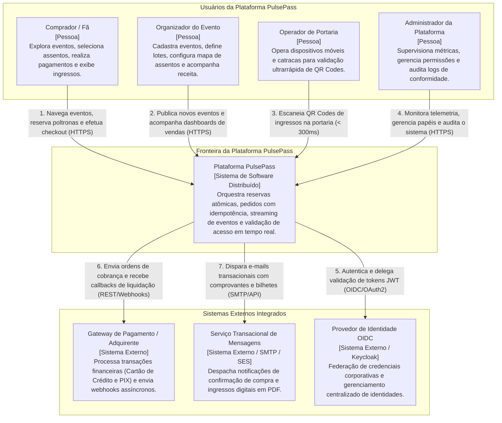
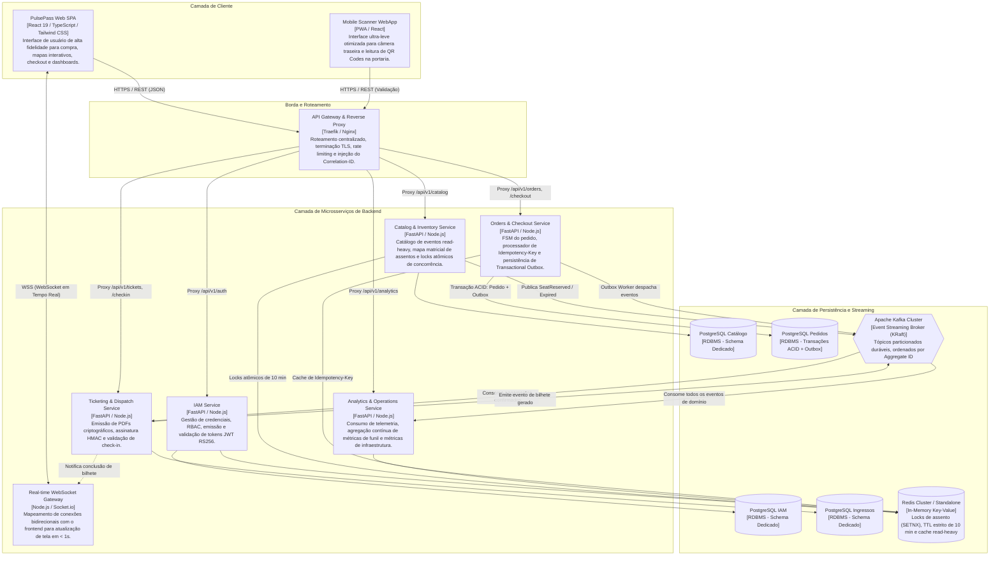
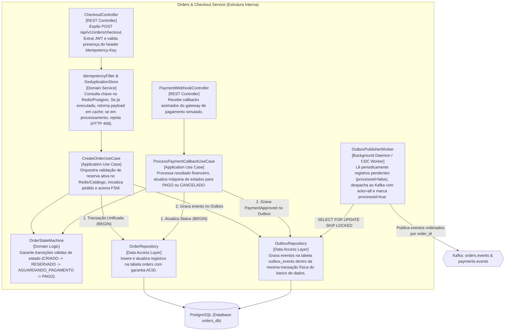
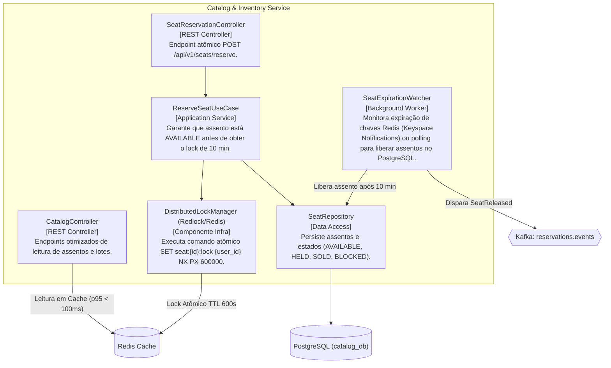
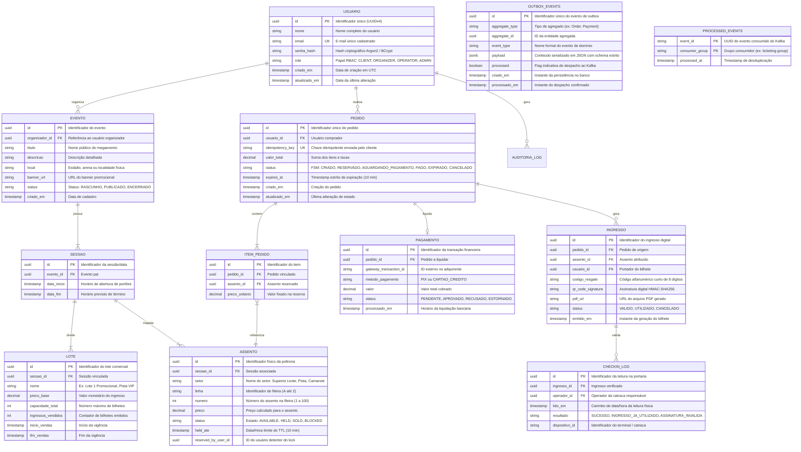
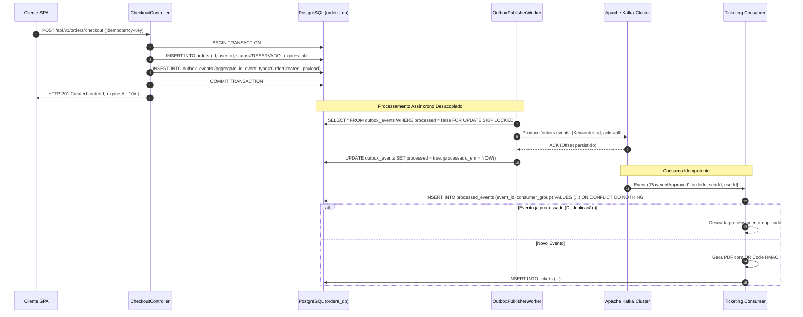
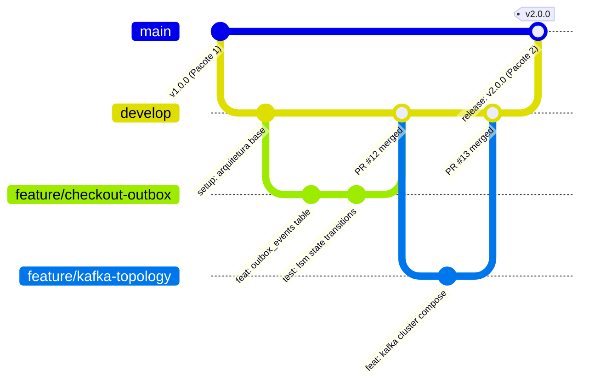

# Technical Specification & Pacote 2: PulsePass
**Documento de Especificação Técnica e Entregáveis do Pacote 2: Arquitetura e Infraestrutura de Desenvolvimento**  
**Projeto Integrador de Construção de Software – 2026/2**  
**Pontifícia Universidade Católica do Rio Grande do Sul (PUCRS) – Escola Politécnica**  
**Autor:** The Autonomous Development Team (@pm - Product Manager & Lead Architect)  
**Status:** Aguardando Aprovação do Usuário (Approval Gate)  

---

## Sumário Executivo (Executive Summary)

O **PulsePass** é uma plataforma distribuída de alta disponibilidade e baixa latência concebida para gerenciar bilhetagem, reserva atômica concorrente e controle de acesso em tempo real para megaeventos esportivos e culturais (estádios, festivais e convenções). O desafio central do domínio reside na absorção de tráfego em rajadas súbitas (*flash crowd traffic*), com dezenas de milhares de usuários disputando simultaneamente um inventário limitado de assentos.

O presente documento consolida formalmente as especificações de engenharia e os entregáveis obrigatórios do **Pacote 2 – Arquitetura e Infraestrutura de Desenvolvimento**, fornecendo os alicerces estruturais para o ciclo de desenvolvimento:

1. **Arquitetura C4 (Níveis 1, 2 e 3):** Decomposição sistêmica formal abrangendo o diagrama de contexto de sistema (Nível 1), o diagrama de contêineres e topologia física (Nível 2) e o detalhamento de componentes internos dos microsserviços críticos de *Checkout* e *Inventário* (Nível 3).
2. **Modelo de Dados Conceitual e Físico (DER):** Modelagem relacional estrita no PostgreSQL com garantia de integridade referencial, isolamento multi-tenant por microsserviço (*Database-per-Service*), tipagem e índices para consultas de alta performance.
3. **Topologia de Mensageria e Streaming com Apache Kafka:** Estrutura particionada de tópicos, garantias de ordenação causal por chave agregada, mitigação rigorosa do *Dual-Write Dilemma* via padrão **Transactional Outbox** relacional e desduplicação de eventos (*Idempotent Consumer*).
4. **Pipeline Automatizada de CI/CD (GitHub Actions / GitLab CI):** Esteira automatizada de entrega contínua com validação estática (lint), suíte de testes unitários de máquinas de estados ($\ge 70\%$ de cobertura de domínio), testes de integração ponta a ponta com **Testcontainers** reais (PostgreSQL, Kafka e Redis) e auditoria de vulnerabilidades em contêineres.
5. **Processo de Gerenciamento da Configuração de Software (GCS):** Estratégia de ramificação com Gitflow adaptado, políticas de Pull Request com *Branch Protection*, convenção *Conventional Commits* e versionamento semântico (*SemVer*).

---

## 1. Requisitos do Sistema & Restrições de Engenharia

O sistema foi decomposto funcionalmente em cinco frentes autônomas, projetadas com baixo acoplamento e alta coesão:

| Foco Funcional | Módulo de Domínio | Responsabilidade Primária | Restrição de Engenharia |
| :--- | :--- | :--- | :--- |
| **Identidade e Governança** | **IAM Service** | Autenticação stateless JWT (RS256), refresh tokens em cache Redis e controle granular de acesso baseado em papéis (RBAC: *Cliente*, *Organizador*, *Operador*, *Admin*). | Tokens criptograficamente verificáveis de forma distribuída pelos gateways e serviços sem chamadas síncronas de validação. |
| **Inventário e Concorrência** | **Catalog & Inventory Service** | Gestão de eventos, sessões e assentos matriciais (setores numerados e pista). Alocação atômica de assentos via locks distribuídos e devolução automática pós-timeout. | **Zero Overselling:** Nenhuma poltrona pode ser vendida em duplicidade. Latência de leitura no catálogo p95 < 100ms sob 2.000 RPS. |
| **Transações e Checkout** | **Orders & Checkout Service** | Máquina de Estados Finitos (FSM) do pedido, suporte a `Idempotency-Key` (RFC 7231) e persistência transacional com **Transactional Outbox**. | **Atomicidade ACID:** O estado do pedido e o evento no Outbox são persistidos na mesma transação PostgreSQL (`COMMIT`). |
| **Emissão e Portaria** | **Ticketing & Dispatch Service** | Consumo assíncrono de pagamentos, geração de ingressos em PDF com QR Code assinado (HMAC-SHA256) e validação de catraca online/offline. | Validação de check-in na portaria com resposta em menos de 300ms, prevenindo fraudes e clonagem de ingressos. |
| **Telemetria e Operações** | **Analytics & Operations** | Ingestão e agregação contínua de eventos de navegação, funil de conversão e telemetria operacional com orquestração Docker Compose unificada. | Coleta assíncrona desacoplada do fluxo crítico do usuário via streaming em tópicos dedicados do Kafka. |

### Requisitos Não-Funcionais Críticos (RNF)
- **RNF-01 (Consistência Estrita):** Impossibilidade física de venda duplicada (*Zero Overselling*). Lock atômico implementado via Redis (`SET seat:{id}:lock {user_id} NX PX 600000`).
- **RNF-02 (Expiração Rigorosa de Reservas):** TTL de exatamente 10 minutos (600 segundos) para confirmação de pagamento. Timeout com desfazimento atômico e reabertura imediata do assento.
- **RNF-03 (Desacoplamento e Resiliência Assíncrona):** Eliminação de gargalos transacionais HTTP entre checkout e emissão de ingressos através de mensageria assíncrona Kafka.
- **RNF-04 (Idempotência Ponta a Ponta):** Proteção contra retentativas de pagamento duplicadas causadas por instabilidades de rede via chave única enviada no header `Idempotency-Key`.
- **RNF-05 (Mitigação do Dual-Write Dilemma):** A publicação de eventos no Kafka depende estritamente do padrão *Transactional Outbox*, eliminando eventos fantasmas ou eventos perdidos.

---

## 2. Arquitetura de Software no Modelo C4

O modelo C4 documenta a arquitetura de software em diferentes níveis de abstração visual: Contexto de Sistema (Nível 1), Contêineres de Execução (Nível 2) e Componentes Internos (Nível 3).

### 2.1 C4 - Nível 1: Diagrama de Contexto de Sistema

O diagrama de contexto estabelece o escopo da Plataforma PulsePass, suas fronteiras de software, os diferentes perfis de usuários humanos e as integrações com entidades externas.



---

### 2.2 C4 - Nível 2: Diagrama de Contêineres

O diagrama de contêineres descreve a divisão física de responsabilidades, as tecnologias adotadas, as fronteiras de rede e a comunicação síncrona e assíncrona entre clientes, gateways, microsserviços e sistemas de persistência.



---

### 2.3 C4 - Nível 3: Diagrama de Componentes (Microsserviços Críticos)

Para garantir o rigor técnico exigido pelo Pacote 2, detalhamos os componentes internos dos dois microsserviços de maior complexidade de concorrência e transação: o **Orders & Checkout Service** e o **Catalog & Inventory Service**.

#### Componentes: Orders & Checkout Service

Este serviço encapsula o núcleo transacional, o isolamento contra escritas duplicadas (*Dual-Write*) e o controle estrito de idempotência.



#### Componentes: Catalog & Inventory Service (Lock Concorrente)

Responsável por absorver o tráfego maciço de visualização de mapas de assentos e realizar alocações atômicas livres de *race conditions*:



---

## 3. Modelo de Dados Conceitual e Físico

A arquitetura adota o isolamento por microsserviços (*Database-per-Service*), garantindo que cada agregado pertença exclusivamente ao seu bounded context. A integridade física é garantida por tabelas relacionais com chaves primárias UUID v4, chaves estrangeiras com índices associados e colunas com carimbo de data/hora UTC (`timestamptz`).

### 3.1 Diagrama Entidade-Relacionamento (DER)



---

## 4. Estrutura de Mensageria e Streaming com Apache Kafka

O Apache Kafka funciona como o barramento de eventos (*Event Backbone*) da plataforma, permitindo o desacoplamento temporal, resiliência assíncrona e ordenação causal estrita.

### 4.1 Topologia de Tópicos e Chaves de Particionamento

Para preservar a causalidade das transições de estado de cada entidade agregada, as mensagens são obrigatoriamente roteadas utilizando **Partition Keys** baseadas no identificador único do agregado:

| Nome do Tópico | Partições | Replicação | Cleanup Policy | Partition Key | Aggregate Type | Produtor Primário | Consumidores Principais |
| :--- | :---: | :---: | :--- | :--- | :--- | :--- | :--- |
| `reservations.events` | 6 | 3 | `delete` (7 dias) | `seat_id` | `Seat` | Catalog Service | Checkout Service, Analytics Service, Real-time WebSocket |
| `orders.events` | 6 | 3 | `delete` (7 dias) | `order_id` | `Order` | Checkout Service (Outbox) | Analytics Service, WebSocket Gateway |
| `payments.events` | 6 | 3 | `delete` (14 dias) | `order_id` | `Payment` | Checkout Service (Outbox) | Ticketing Service, Analytics Service |
| `tickets.events` | 6 | 3 | `delete` (30 dias) | `ticket_id` | `Ticket` | Ticketing Service | Notification Service, WebSocket Gateway, Analytics |
| `telemetry.events` | 12 | 3 | `delete` (3 dias) | `session_id` | `Telemetry` | Frontend Gateway / Ingress | Analytics Service |

---

### 4.2 Mitigação do Dual-Write Dilemma (Transactional Outbox Pattern)

O problema clássico do Dual-Write ocorre quando um microsserviço precisa alterar dados em seu banco relacional e publicar uma mensagem no broker. Se a escrita no banco tiver sucesso mas o broker falhar, o evento é perdido. Se a mensagem for enviada primeiro e o banco falhar, o sistema emite eventos fantasmas.

**Solução Arquitetural Obrigatória:**
1. **Transação Relacional Atômica:** Quando um pedido é atualizado ou criado, a escrita na tabela `orders` e a inserção do evento correspondente na tabela `outbox_events` ocorrem na **mesma transação ACID (`BEGIN ... COMMIT`)**.
2. **Outbox Publisher Worker:** Um daemon em segundo plano lê registros pendentes (`processed = false`) utilizando a cláusula `SELECT ... FOR UPDATE SKIP LOCKED` para permitir paralelismo sem concorrência destrutiva entre réplicas.
3. **Publicação com `acks=all`:** O worker despacha a mensagem ao Kafka aguardando confirmação do broker e quorum de réplicas em disco (`min.insync.replicas=2`).
4. **Confirmação Local:** Apenas após a recepção do ACK do Kafka, o worker marca `processed = true` e preenche `processado_em`.



---

### 4.3 Schemas Estruturados dos Eventos de Domínio

Os eventos transmitidos pelo Kafka seguem o formato estruturado padrão com metadados unificados para rastreabilidade (*CloudEvents / Envelope Pattern*):

#### Evento: `OrderCreated` (Tópico: `orders.events`)
```json
{
  "specversion": "1.0",
  "id": "e4b2d1c0-5a3d-4c8e-bf91-112233445566",
  "source": "/pulsepass/orders-service",
  "type": "com.pulsepass.order.created",
  "datacontenttype": "application/json",
  "time": "2026-10-26T21:40:00Z",
  "correlation_id": "corr-8f192b-4721",
  "data": {
    "order_id": "7f9c2d11-4432-4821-9921-001122334455",
    "user_id": "11223344-5566-7788-99aa-bbccddeeff00",
    "status": "RESERVADO",
    "valor_total": 450.00,
    "expires_at": "2026-10-26T21:50:00Z",
    "items": [
      {
        "assento_id": "99887766-5544-3322-1100-aabbccddeeff",
        "setor": "Cadeira Inferior Leste",
        "linha": "C",
        "numero": 14,
        "preco": 450.00
      }
    ]
  }
}
```

#### Evento: `PaymentApproved` (Tópico: `payments.events`)
```json
{
  "specversion": "1.0",
  "id": "a9f8b7c6-d5e4-3c2b-1a0f-998877665544",
  "source": "/pulsepass/orders-service",
  "type": "com.pulsepass.payment.approved",
  "datacontenttype": "application/json",
  "time": "2026-10-26T21:42:30Z",
  "correlation_id": "corr-8f192b-4721",
  "data": {
    "payment_id": "55443322-1100-aabb-ccdd-eeff00112233",
    "order_id": "7f9c2d11-4432-4821-9921-001122334455",
    "user_id": "11223344-5566-7788-99aa-bbccddeeff00",
    "metodo_pagamento": "PIX",
    "valor": 450.00,
    "gateway_transaction_id": "E2026102621423012938472910"
  }
}
```

---

## 5. Pipeline de Desenvolvimento e Automação CI/CD

A esteira de integração e entrega contínua (CI/CD) foi projetada para ser executada em GitHub Actions ou GitLab CI a cada *Pull Request* e a cada *Merge* nas branches `develop` e `main`.

### 5.1 Desenho Esquemático da Esteira Automatizada

```mermaid
flowchart TD
    TRIGGER(["Disparo: Pull Request ou Push na branch 'develop' / 'main'"]) --> STAGE1
    
    subgraph STAGE1["Estágio 1: Análise Estática & Lint"]
        JOB_LINT["Linters & Format Check<br>(ESLint / Ruff / Flake8 / Oxlint)"]
        JOB_TYPE["Type Checking Estrito<br>(TypeScript tsc --noEmit / Mypy)"]
        JOB_SECURITY["Security SAST<br>(SonarQube / Bandit / npm audit)"]
    end
    
    STAGE1 --> STAGE2
    
    subgraph STAGE2["Estágio 2: Testes Unitários de Domínio"]
        JOB_UNIT_FSM["Testes de Máquinas de Estado (FSM)<br>Validação de transições do Pedido e Regras de Negócio<br>Meta: Cobertura >= 70%"]
        JOB_UNIT_IDEM["Testes de Idempotência & Hash<br>Validação de chaves de desduplicação e payloads"]
    end
    
    STAGE2 --> STAGE3
    
    subgraph STAGE3["Estágio 3: Testes de Integração com Testcontainers"]
        JOB_TC_DB["Testcontainers PostgreSQL<br>Validação de transações ACID e Outbox atômico"]
        JOB_TC_KAFKA["Testcontainers Kafka & Redis<br>Produção acks=all e consumo idempotente com deduplicação"]
    end
    
    STAGE3 --> STAGE4
    
    subgraph STAGE4["Estágio 4: Build de Contêineres OCI & Scan"]
        JOB_DOCKER_BUILD["Docker Multi-Stage Build<br>Compilação e empacotamento das imagens de microsserviços"]
        JOB_CONTAINER_SCAN["Vulnerability Container Scan<br>(Trivy / Snyk) - Bloqueio em caso de falhas CVE altas/críticas"]
    end
    
    STAGE4 --> STAGE5
    
    subgraph STAGE5["Estágio 5: Deploy & Validação de Ambiente"]
        JOB_COMPOSE_VALIDATE["Validação Docker Compose<br>docker compose config & smoke test dos healthchecks"]
        JOB_PREVIEW["Deploy Preview / Staging<br>Publicação automatizada em ambiente de homologação"]
    end
    
    STAGE5 --> SUCCESS(["Esteira Aprovada: Status Check Verde no PR"])
```



### 5.2 Detalhamento dos Jobs e Critérios de Aceite

1. **Lint & Type-Check:** Executado em menos de 60 segundos. Falhas de digitação, formatação fora do padrão ou tipagem frouxa (`any`) interrompem imediatamente o pipeline.
2. **Suíte de Testes Unitários:** Execução isolada em memória sem I/O de rede ou disco. Cobertura mínima obrigatória de **70%** nas classes de domínio e transições de estado da FSM.
3. **Testes de Integração com Testcontainers:**
   - Instanciação de contêineres temporários descartáveis de PostgreSQL 16 e Kafka KRaft real via código (`testcontainers-node` ou `testcontainers-python`).
   - Valida a atomicidade do padrão *Transactional Outbox* e a garantia de que nenhuma mensagem duplicada seja processada duas vezes no *Ticketing Service*.
4. **Construção de Imagens e Scan de Segurança:** Geração de imagens otimizadas baseadas em Alpine/Distroless com scan do Trivy. Builds com vulnerabilidades críticas conhecidas (CVEs) têm merge bloqueado.
5. **Orquestração Local Reprodutível:** A validação final assegura que o arquivo `docker-compose.yml` sobe todos os serviços e que todos os healthchecks respondem com `healthy` em até 120 segundos.

---

## 6. Processo de Gerenciamento da Configuração de Software (GCS)

Para assegurar governança estrita e rastreabilidade absoluta de cada linha de código, o projeto adota um fluxo de trabalho baseado no **Gitflow Adaptado** e políticas rigorosas de proteção de branch.

### 6.1 Topologia de Branches e Convenções



- **`main`:** Representa o código em estado de produção estável. Todo commit em `main` corresponde a uma entrega formal avaliada da disciplina e deve conter uma Git Tag semântica assinada (`v1.0.0`, `v2.0.0`).
- **`develop`:** Linha principal de integração contínua. Reúne o trabalho concluído de todas as frentes funcionais aprovadas em Pull Request.
- **`feature/<modulo>-<descricao>`:** Branches temporárias criadas a partir de `develop` para implementação de novas funcionalidades (ex: `feature/catalog-redis-lock`, `feature/orders-outbox-worker`).
- **`bugfix/<modulo>-<descricao>`:** Branches para resolução de defeitos identificados durante os testes integrados.
- **`hotfix/<descricao>`:** Branches de intervenção emergencial ramificadas a partir de `main`.

### 6.2 Políticas de Pull Request e Branch Protection

As branches `main` e `develop` possuem proteção de branch (*Branch Protection Rules*) ativada:
1. **Bloqueio de Commits Diretos:** Nenhum membro da equipe ou agente autônomo pode realizar `git push` direto para `main` ou `develop`.
2. **Revisão de Código Obrigatória (Peer Review):** Todo Pull Request exige no mínimo uma aprovação de outro engenheiro da equipe ou do papel auditor `@qa`.
3. **Status Checks Obrigatórios:** O botão de Merge permanece travado enquanto todas as verificações automatizadas da pipeline de CI (lint, testes unitários $\ge 70\%$ e Testcontainers) não estiverem concluídas com status verde.
4. **Proibição de Force Push e Deletion:** Comandos de reescrita histórica destrutiva (`git push --force`) são expressamente desabilitados pelo servidor Git.

### 6.3 Convenção de Mensagens de Commit (Conventional Commits)

Todas as alterações no histórico de versões devem aderir rigorosamente ao padrão *Conventional Commits*:
- `feat(orders): implementar tabela outbox_events e persistencia atomica`
- `fix(catalog): corrigir race condition no lock distribuido do redis`
- `test(fsm): adicionar testes cobrindo expiracao de pedido apos 10 minutos`
- `docs(arch): adicionar diagramas C4 nivel 3 do servico de checkout`
- `chore(deps): atualizar testcontainers para versao mais recente`

---

## 7. Arquitetura de Software e Tech Stack Recomendada

Com base nas exigências de alta vazão, baixa latência, transacionalidade ACID e tipagem estrita, a equipe técnica recomenda a seguinte composição tecnológica para a implementação física (Pacotes 3 e 4):

| Camada | Tecnologia Adotada | Justificativa Técnica |
| :--- | :--- | :--- |
| **Frontend SPA** | **React 19 + TypeScript + Tailwind CSS v4 + Vite** | Compatibilidade total com os protótipos de alta fidelidade desenvolvidos no diretório `design-reference/`, renderização performática e tipagem fim a fim. |
| **Backend Framework** | **Node.js (TypeScript / Fastify) ou Python 3.12 (FastAPI / Asyncpg)** | Modelo não-bloqueante de E/S assíncrona orientado a eventos, alta taxa de throughput para I/O intensivo, bibliotecas maduras para Testcontainers e ecossistema nativo para Kafka e Redis. |
| **Banco de Dados Relacional** | **PostgreSQL 16 (Alpine)** | Suporte completo a transações ACID relacionais, recursos nativos para JSONB (payloads de eventos) e comando `SELECT FOR UPDATE SKIP LOCKED` indispensável para workers do Transactional Outbox. |
| **Cache & Locks Concorrentes** | **Redis 7 (Alpine)** | Operações atômicas de alta performance em memória (`SETNX`), TTL nativo para a expiração de 10 minutos (600s) e suporte a locks distribuídos Redlock. |
| **Event Streaming Broker** | **Apache Kafka 3.7+ (Modo KRaft)** | Eliminação da dependência legado do Zookeeper, durabilidade de mensagens em disco, particionamento ordenado por chave e taxa de throughput superior a dezenas de milhares de mensagens por segundo. |
| **Gestão do Broker** | **Kafka UI (provectuslabs)** | Interface gráfica leve e intuitiva para visualização em tempo real de tópicos, mensagens, offsets de partições e grupos consumidores. |
| **Suíte de Testes** | **Vitest / Pytest + Testcontainers** | Execução rápida de testes unitários da FSM e testes de integração com instâncias reais de banco e mensageria em contêineres descartáveis. |

---

## 8. Guia de Execução Local e Reprodutibilidade DevOps

Toda a infraestrutura do PulsePass é empacotada para execução local determinística e reprodutível através de contêineres Docker:

```yaml
# Estrutura base da topologia Docker Compose (docker-compose.yml)
version: '3.8'

services:
  postgres:
    image: postgres:16-alpine
    container_name: pulsepass-postgres
    environment:
      POSTGRES_USER: pulsepass
      POSTGRES_PASSWORD: pulsepass_secret
      POSTGRES_DB: pulsepass_master
    ports:
      - "5432:5432"
    volumes:
      - pgdata:/var/lib/postgresql/data
      - ./infrastructure/postgres/init-schemas.sql:/docker-entrypoint-initdb.d/init.sql
    healthcheck:
      test: ["CMD-SHELL", "pg_isready -U pulsepass"]
      interval: 5s
      timeout: 5s
      retries: 5

  redis:
    image: redis:7-alpine
    container_name: pulsepass-redis
    ports:
      - "6379:6379"
    command: ["redis-server", "--appendonly", "yes"]
    healthcheck:
      test: ["CMD", "redis-cli", "ping"]
      interval: 5s
      timeout: 3s
      retries: 5

  kafka:
    image: confluentinc/cp-kafka:7.6.0
    container_name: pulsepass-kafka
    ports:
      - "9092:9092"
      - "29092:29092"
    environment:
      KAFKA_NODE_ID: 1
      KAFKA_LISTENER_SECURITY_PROTOCOL_MAP: 'CONTROLLER:PLAINTEXT,PLAINTEXT:PLAINTEXT,PLAINTEXT_HOST:PLAINTEXT'
      KAFKA_ADVERTISED_LISTENERS: 'PLAINTEXT://kafka:29092,PLAINTEXT_HOST://localhost:9092'
      KAFKA_OFFSETS_TOPIC_REPLICATION_FACTOR: 1
      KAFKA_PROCESS_ROLES: 'broker,controller'
      KAFKA_CONTROLLER_QUORUM_VOTERS: '1@kafka:29093'
      KAFKA_LISTENERS: 'PLAINTEXT://0.0.0.0:29092,CONTROLLER://0.0.0.0:29093,PLAINTEXT_HOST://0.0.0.0:9092'
      KAFKA_INTER_BROKER_LISTENER_NAME: 'PLAINTEXT'
      KAFKA_CONTROLLER_LISTENER_NAMES: 'CONTROLLER'
      CLUSTER_ID: 'MkU3OEVBNTcwNTJENDM2Qk'
    healthcheck:
      test: ["CMD", "nc", "-z", "localhost", "9092"]
      interval: 10s
      timeout: 5s
      retries: 5

  kafka-ui:
    image: provectuslabs/kafka-ui:latest
    container_name: pulsepass-kafka-ui
    ports:
      - "8080:8080"
    environment:
      KAFKA_CLUSTERS_0_NAME: pulsepass-cluster
      KAFKA_CLUSTERS_0_BOOTSTRAPSERVERS: kafka:29092
    depends_on:
      kafka:
        condition: service_healthy

volumes:
  pgdata:
```

### Comandos de Inicialização e Verificação do Ambiente
```bash
# 1. Subida da infraestrutura completa conteinerizada
docker compose up -d

# 2. Verificação de status e prontidão dos serviços
docker compose ps

# 3. Acesso aos consoles de monitoramento local:
# Painel Web do Kafka UI:  http://localhost:8080
# Banco PostgreSQL:        localhost:5432 (pulsepass / pulsepass_secret)
# Servidor Redis:          localhost:6379
```

---

## 9. Checklist de Conformidade com o Pacote 2 (PUCRS 2026/2)

| Entregável Obrigatório no Enunciado Oficial | Status | Seção Correspondente |
| :--- | :---: | :--- |
| **Descrição da arquitetura no Modelo C4 (Níveis 1, 2 e 3)** | Concluído | [Seção 2: C4 Nível 1 (Contexto), Nível 2 (Contêineres) e Nível 3 (Componentes)](#2-arquitetura-de-software-no-modelo-c4) |
| **Descrição do Modelo de Dados Conceitual e Físico (DER)** | Concluído | [Seção 3: Diagrama DER e Atributos de Domínio](#3-modelo-de-dados-conceitual-e-físico) |
| **Descrição da estrutura de mensageria do Kafka** | Concluído | [Seção 4: Tópicos, Chaves, Schemas, Outbox e Deduplicação](#4-estrutura-de-mensageria-e-streaming-com-apache-kafka) |
| **Descrição esquemática da Pipeline de desenvolvimento (CI/CD)** | Concluído | [Seção 5: Pipeline no GitHub Actions / GitLab com Testcontainers](#5-pipeline-de-desenvolvimento-e-automação-cicd) |
| **Descrição do Processo de GCS (Configuração de Software)** | Concluído | [Seção 6: Gitflow, Branch Protection, Commits Semânticos e SemVer](#6-processo-de-gerenciamento-da-configuração-de-software-gcs) |

---

## 10. Próximos Passos (Transição para o Pacote 3 / Checkpoint de Desenvolvimento)

Após a aprovação deste documento pelo desenvolvedor responsável:
1. **Passo para o `@engineer` (Full-Stack Engineer):** Iniciar o scaffolding físico do repositório no diretório de construção, configurando o `docker-compose.yml`, scripts de migração relacional do PostgreSQL (tabelas de pedidos, assentos e outbox), clientes Redis e consumers Kafka.
2. **Passo para o `@qa` (QA Engineer):** Implementar os testes unitários de transição de estado da FSM do pedido garantindo $\ge 70\%$ de cobertura de código e a suíte de testes de integração com Testcontainers.
3. **Passo para o `@devops` (DevOps Master):** Configurar o workflow do GitHub Actions (`.github/workflows/ci.yml`) integrando todas as etapas da esteira de validação automática.
